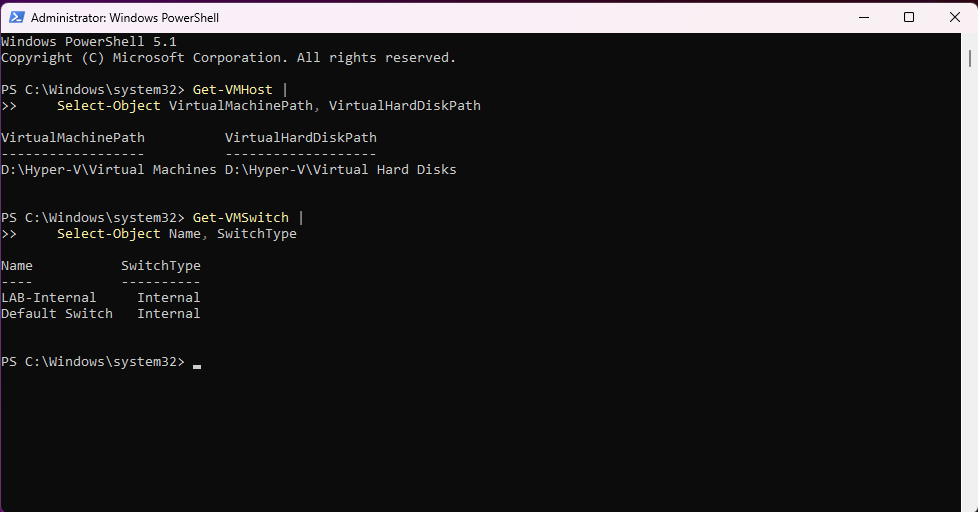
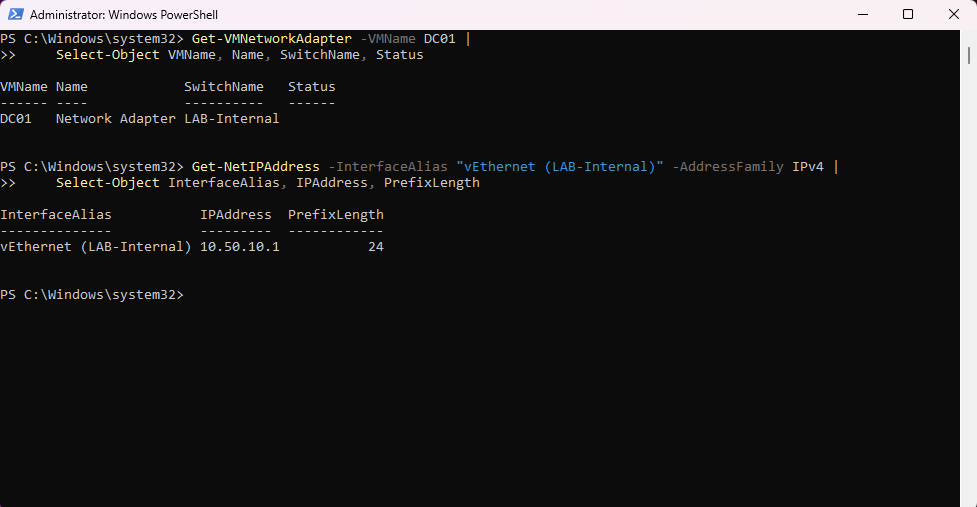
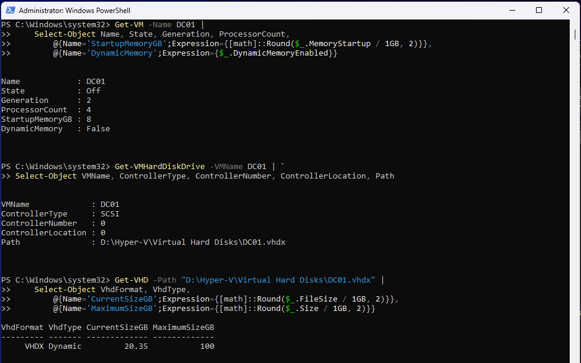

# Hyper-V Host and Network Infrastructure

## Objective

Document the configuration and validation of the ARGUS Hyper-V host, DC01 virtual machine, virtual storage, and isolated lab network.

This environment simulates a small enterprise Windows infrastructure while keeping lab traffic separate from the host's normal network connection.

## 1. Host Infrastructure

ARGUS is a dedicated Windows 11 Pro workstation running Microsoft Hyper-V.

| Component | Configuration |
|---|---|
| Hostname | ARGUS |
| Operating System | Windows 11 Pro |
| Processor | AMD Ryzen 9 9955HX |
| Physical Memory | 64 GB |
| Virtualization Platform | Microsoft Hyper-V |

### Storage Configuration

| Volume | Purpose |
|---|---|
| C: | Host operating system, applications, and Git documentation |
| D: | Hyper-V virtual machines and virtual hard disks |
| E: | External offline backup and recovery storage |

The Hyper-V default storage locations were verified using:

```powershell
Get-VMHost |
    Select-Object VirtualMachinePath, VirtualHardDiskPath
```

Verified locations:

```text
VirtualMachinePath: D:\Hyper-V\Virtual Machines
VirtualHardDiskPath: D:\Hyper-V\Virtual Hard Disks
```



## 2. Hyper-V Virtual Networking

Two virtual switches were identified:

| Virtual Switch | Switch Type | Purpose |
|---|---|---|
| LAB-Internal | Internal | Isolated enterprise lab networking |
| Default Switch | Internal | Windows-managed Hyper-V networking |

The switches were enumerated using:

```powershell
Get-VMSwitch |
    Select-Object Name, SwitchType
```

### LAB-Internal Network

The lab uses the following addressing scheme:

| System | IPv4 Address | Prefix |
|---|---|---|
| ARGUS lab adapter | 10.50.10.1 | /24 |
| DC01 | 10.50.10.10 | /24 |

The `LAB-Internal` switch allows communication between the Hyper-V host and connected virtual machines without directly bridging them onto the physical network.

No default gateway is configured for the isolated lab network.

### Network Validation

DC01's virtual network connection was inspected using:

```powershell
Get-VMNetworkAdapter -VMName DC01 |
    Select-Object VMName, Name, SwitchName, Status
```

The host's lab IPv4 configuration was inspected using:

```powershell
Get-NetIPAddress -InterfaceAlias "vEthernet (LAB-Internal)" -AddressFamily IPv4 |
    Select-Object InterfaceAlias, IPAddress, PrefixLength
```

Results confirmed that DC01 is attached to `LAB-Internal` and the ARGUS lab adapter uses `10.50.10.1/24`.



## 3. DC01 Virtual Machine Configuration

DC01 is a Windows Server 2025 Standard Evaluation virtual machine providing Active Directory Domain Services and DNS for `corp.example.com`.

| Setting | Verified Configuration |
|---|---|
| VM Name | DC01 |
| Generation | 2 |
| Virtual Processors | 4 |
| Startup Memory | 8 GB |
| Dynamic Memory | Disabled |
| Virtual Disk Format | VHDX |
| Disk Type | Dynamically Expanding |
| Current VHDX File Size | 20.35 GB |
| Maximum Disk Capacity | 100 GB |
| Disk Controller | SCSI 0, Location 0 |

### VM Resource Validation

```powershell
Get-VM -Name DC01 |
    Select-Object Name, State, Generation, ProcessorCount,
        @{Name='StartupMemoryGB';Expression={[math]::Round($_.MemoryStartup / 1GB, 2)}},
        @{Name='DynamicMemory';Expression={$_.DynamicMemoryEnabled}}
```

### Virtual Disk Attachment

```powershell
Get-VMHardDiskDrive -VMName DC01 |
    Select-Object VMName, ControllerType, ControllerNumber, ControllerLocation, Path
```

### Virtual Disk Provisioning

```powershell
Get-VHD -Path "D:\Hyper-V\Virtual Hard Disks\DC01.vhdx" |
    Select-Object VhdFormat, VhdType,
        @{Name='CurrentSizeGB';Expression={[math]::Round($_.FileSize / 1GB, 2)}},
        @{Name='MaximumSizeGB';Expression={[math]::Round($_.Size / 1GB, 2)}}
```

The VHDX currently consumes approximately 20.35 GB of host storage and can expand to a maximum virtual capacity of 100 GB.

Dynamic disk provisioning reduces initial storage consumption, while fixed VM memory allocation provides a predictable memory configuration.



## 4. Security Considerations

The infrastructure incorporates several security-focused design decisions:

- Dedicated lab networking using an internal Hyper-V virtual switch
- No default gateway on the isolated lab network
- Separate host administrator and standard-user accounts
- Hyper-V virtual machine storage separated from the host operating system volume
- Offline external backup storage for recovery
- Restricted host-to-domain-controller firewall access

An internal virtual switch provides network separation, but it is not a complete security boundary against compromise of the Hyper-V host.

## 5. Validation Summary

The following configuration checks were completed successfully:

- [x] Verified Hyper-V default storage paths
- [x] Enumerated installed virtual switches
- [x] Confirmed DC01 attachment to LAB-Internal
- [x] Verified ARGUS lab IPv4 address and subnet prefix
- [x] Verified DC01 processor and memory configuration
- [x] Verified DC01 virtual disk attachment
- [x] Verified dynamically expanding VHDX configuration

## Conclusion

ARGUS provides a dedicated Hyper-V platform for an isolated Windows enterprise lab.

The host storage layout, internal virtual network, and DC01 virtual hardware have been inspected using PowerShell and documented with supporting screenshots.

Future work will extend this infrastructure with Windows client deployment, Group Policy, PowerShell automation, security auditing, and recovery testing.