# ARGUS — BitLocker Encryption and Backup Security

## Overview

This document describes the implementation and validation of BitLocker Drive Encryption on ARGUS, a Windows 11 Pro Hyper-V host supporting a simulated enterprise Active Directory environment.

The objective was to protect the operating system, virtual machine storage, and offline backup media against unauthorized offline access while preserving normal Hyper-V functionality.

All three storage volumes were configured with XTS-AES-256 encryption.

## Storage Security Architecture

| Volume | Purpose | Encryption | Unlock Method |
|---|---|---|---|
| C: | Windows 11 Pro operating system | XTS-AES-256 | TPM |
| D: | Hyper-V virtual machine storage | XTS-AES-256 | Automatic unlock |
| E: | External offline backup storage | XTS-AES-256 | Password |

### Security Design Decisions

**C: — Operating System**

The Windows operating system volume uses a TPM-based key protector. This allows normal startup without requiring a separate BitLocker PIN while protecting the volume against offline disk access.

A separate 48-digit recovery password was created and securely stored outside ARGUS.

**D: — Hyper-V Storage**

The dedicated Hyper-V storage volume uses automatic unlocking after the Windows operating system volume becomes available.

This allows virtual machines to access their virtual hard disks without requiring manual drive unlocking after each host restart.

An independent recovery password was also created and stored securely.

**E: — Offline Backup**

The external backup drive uses password-based unlocking rather than automatic unlocking.

This design supports keeping the backup drive disconnected and physically isolated when not in use.

A separate recovery password was configured and securely stored.

## Recovery Key Management

Recovery credentials for all three volumes were stored independently of ARGUS in a secure password manager.

Recovery passwords, unlock passwords, and encryption key material are intentionally excluded from this public repository.

Each volume maintains an independent recovery mechanism.

## Pre-Encryption Readiness

Before enabling BitLocker on the internal SSDs, the host's storage health, TPM configuration, Secure Boot status, and Windows recovery environment were evaluated.

### Initial BitLocker Status

The operating system and Hyper-V storage volumes were initially unencrypted.

```powershell

Get-BitLockerVolume -MountPoint C:,D: |

    Select-Object MountPoint, VolumeType, VolumeStatus,

        EncryptionPercentage, ProtectionStatus,

        EncryptionMethod, AutoUnlockEnabled

```

Both volumes initially reported:

- `VolumeStatus`: `FullyDecrypted`

- `EncryptionPercentage`: `0`

- `ProtectionStatus`: `Off`

- `EncryptionMethod`: `None`

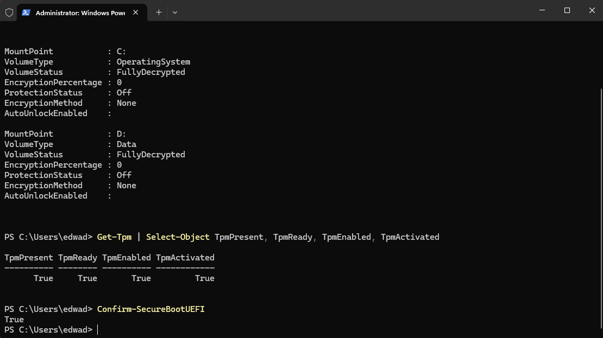

### TPM and Secure Boot Validation

The ARGUS host was verified to have a functioning Trusted Platform Module (TPM) and enabled UEFI Secure Boot.

```powershell

Get-Tpm |

    Select-Object TpmPresent, TpmReady, TpmEnabled, TpmActivated

Confirm-SecureBootUEFI

```

All four TPM properties returned `True`, and Secure Boot was confirmed enabled.

Both internal NTFS volumes also reported a `Healthy` storage status.

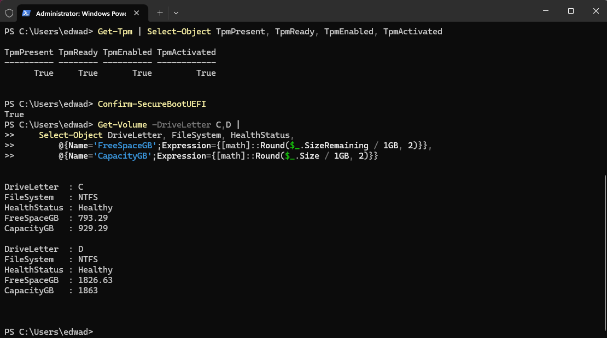

### Windows Recovery Environment

Windows Recovery Environment (WinRE) was verified before encrypting the operating system volume.

```powershell

reagentc /info

```

The command confirmed that WinRE was enabled and configured on the system recovery partition.

The Windows servicing pending-reboot registry flag was also checked:

```powershell

Test-Path "HKLM:\SOFTWARE\Microsoft\Windows\CurrentVersion\Component Based Servicing\RebootPending"

```

The result was `False`, indicating that this particular servicing check did not identify a pending restart.

### Recovery Preparation

Before rebooting encrypted volumes, recovery passwords were generated and stored securely outside the host.

No recovery passwords, unlock passwords, or encryption key material were committed to Git.

These readiness checks established the baseline for the subsequent BitLocker deployment.

## Operating System Encryption — C:

The Windows 11 Pro operating system volume was encrypted using BitLocker with XTS-AES-256.

A TPM-based protector was selected to support unattended startup, while an independent recovery password provides a recovery mechanism if normal TPM unlocking becomes unavailable.

### Enabling BitLocker

BitLocker was enabled from an elevated PowerShell session using the dedicated administrative account.

```powershell

Enable-BitLocker `

    -MountPoint "C:" `

    -EncryptionMethod XtsAes256 `

    -TpmProtector `

    -SkipHardwareTest `

    -ErrorAction Stop

```

The `-SkipHardwareTest` parameter bypassed the preliminary BitLocker startup validation. A controlled restart and post-reboot verification were performed after encryption completed.

### Configuring Recovery Protection

An independent 48-digit recovery password protector was added:

```powershell

Add-BitLockerKeyProtector `

    -MountPoint "C:" `

    -RecoveryPasswordProtector `

    -ErrorAction Stop

```

The recovery password was securely stored outside ARGUS and excluded from the repository.

Protector types were verified without displaying sensitive recovery information:

```powershell

(Get-BitLockerVolume -MountPoint "C:").KeyProtector |

    Select-Object KeyProtectorType

```

The resulting configuration included:

| Protector | Purpose |
|---|---|
| `Tpm` | Unlocks the operating system volume during normal startup |
| `RecoveryPassword` | Provides an independent recovery mechanism |

### Encryption Progress

The initial verification showed encryption in progress using XTS-AES-256.

```powershell

Get-BitLockerVolume -MountPoint "C:" |

    Select-Object MountPoint, VolumeStatus,

        EncryptionPercentage, ProtectionStatus, EncryptionMethod

```

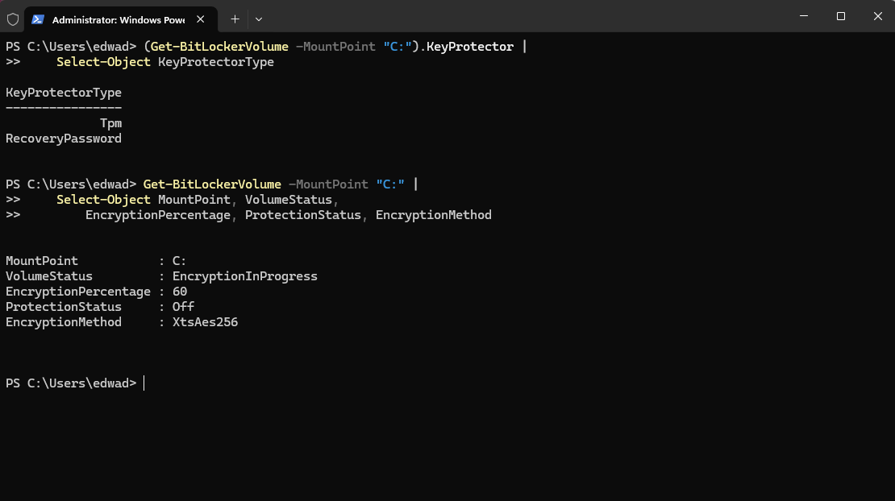

### Encryption Completion

After encryption finished, the operating system volume reported:

| Property | Result |
|---|---|
| VolumeStatus | `FullyEncrypted` |
| EncryptionPercentage | `100` |
| ProtectionStatus | `On` |
| EncryptionMethod | `XtsAes256` |

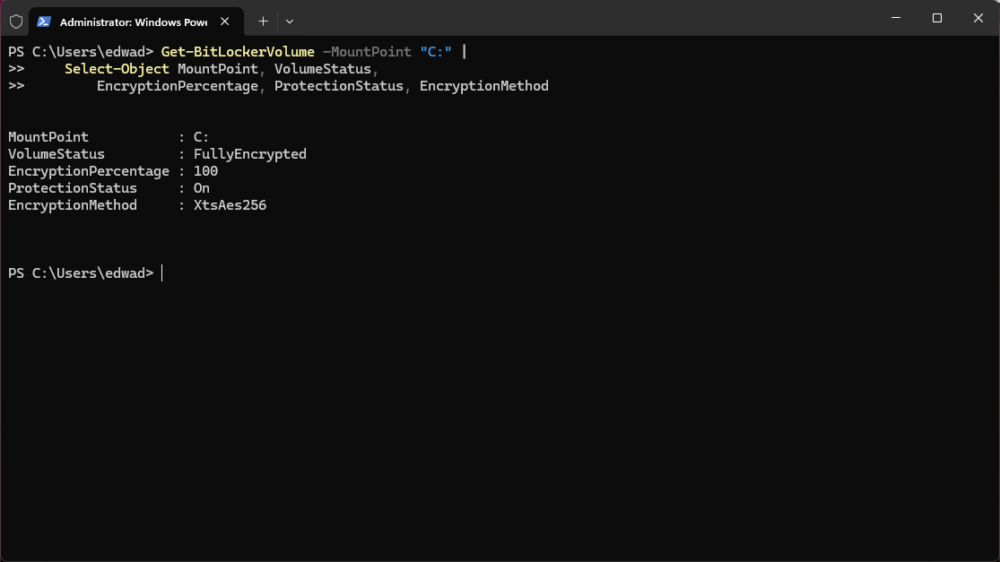

### Post-Reboot Validation

ARGUS was restarted to verify that the TPM-based protector could unlock the operating system volume during a normal startup.

Windows started successfully without requesting the BitLocker recovery password.

A subsequent PowerShell verification confirmed that the operating system volume remained fully encrypted with protection enabled.

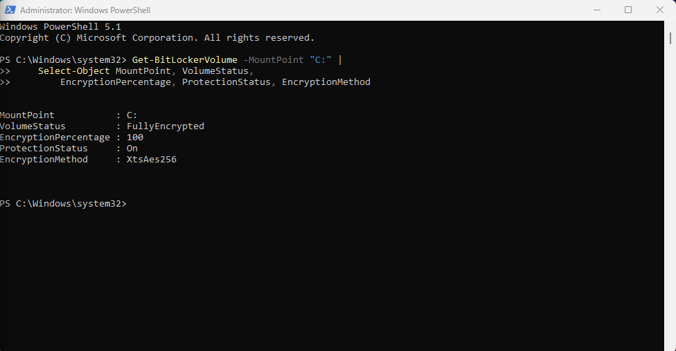

**Result:** Operating system encryption was completed successfully, and TPM-based unlocking was validated across a host restart.

## Hyper-V Storage Encryption — D:

The dedicated 2 TB Samsung NVMe SSD stores the Hyper-V virtual machine files, including the virtual hard disk for DC01.

BitLocker was configured with XTS-AES-256 encryption, an independent recovery password, and automatic unlocking through the protected Windows operating system volume.

### Pre-Encryption Validation

Before enabling encryption, the domain controller was shut down gracefully to minimize virtual disk activity during the operation.

The VM state was verified:

```powershell

Get-VM |

    Select-Object Name, State

```

DC01 reported `Off`.

The storage volume was checked for filesystem health and existing BitLocker protection:

```powershell

Get-Volume -DriveLetter D |

    Select-Object DriveLetter, FileSystem, HealthStatus

Get-BitLockerVolume -MountPoint "D:" |

    Select-Object MountPoint, VolumeStatus,

        EncryptionPercentage, ProtectionStatus

```

The volume reported a healthy NTFS filesystem and was initially fully decrypted.

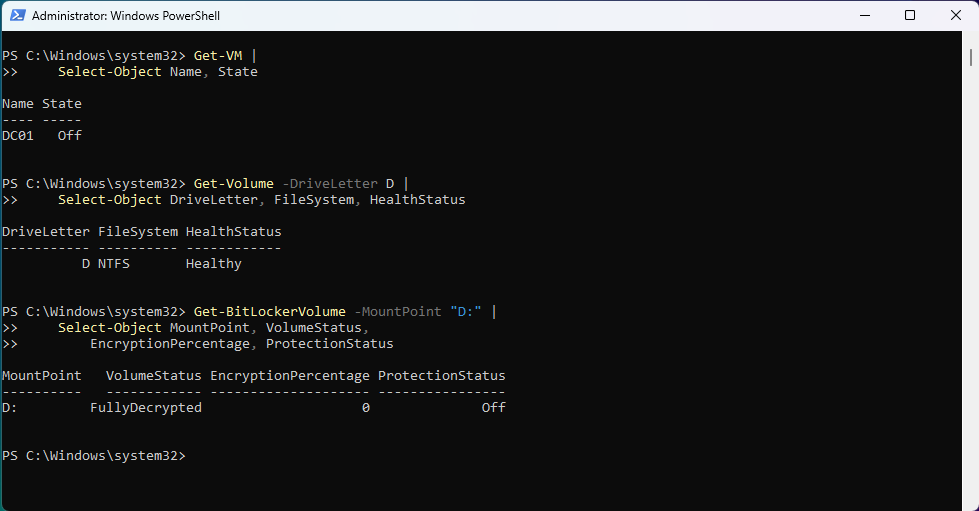

### Enabling BitLocker

BitLocker was enabled using an independent recovery-password protector:

```powershell

Enable-BitLocker `

    -MountPoint "D:" `

    -EncryptionMethod XtsAes256 `

    -RecoveryPasswordProtector `

    -ErrorAction Stop

```

The generated recovery password was stored securely outside ARGUS.

The protector type and encryption progress were verified without exposing recovery credentials.

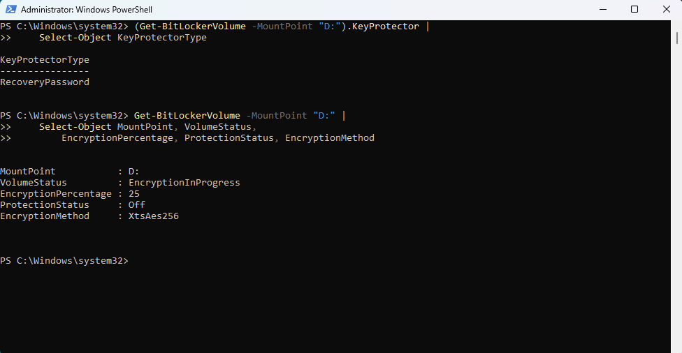

### Configuring Automatic Unlocking

Because C: was already encrypted and had passed its startup validation, automatic unlocking could be configured for the fixed data volume.

```powershell

Enable-BitLockerAutoUnlock -MountPoint "D:" -ErrorAction Stop

```

This configuration allows Windows to unlock D: automatically after the operating system volume becomes available.

The auto-unlock mechanism uses an external-key protector whose unlocking information is stored on the protected operating system volume.

The independent recovery-password protector was retained for recovery scenarios.

Automatic unlocking was verified using:

```powershell

Get-BitLockerVolume -MountPoint "D:" |

    Select-Object MountPoint, AutoUnlockEnabled,

        VolumeStatus, EncryptionPercentage, ProtectionStatus

```

The `AutoUnlockEnabled` property returned `True`.

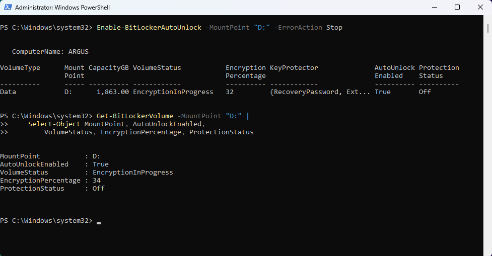

### Encryption Completion

After encryption completed, the Hyper-V storage volume reported:

| Property | Result |
|---|---|
| VolumeStatus | `FullyEncrypted` |
| EncryptionPercentage | `100` |
| ProtectionStatus | `On` |
| AutoUnlockEnabled | `True` |
| EncryptionMethod | `XtsAes256` |

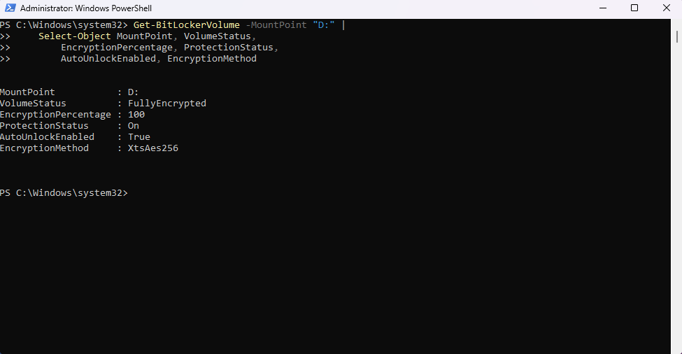

### Post-Reboot Validation

ARGUS was restarted to verify that both internal volumes remained protected and that the Hyper-V storage volume unlocked automatically.

```powershell

Get-BitLockerVolume -MountPoint C:,D: |

    Select-Object MountPoint, VolumeStatus,

        EncryptionPercentage, ProtectionStatus,

        AutoUnlockEnabled, EncryptionMethod

```

Both volumes reported `FullyEncrypted`, `100`, and `On`. The D: volume additionally reported `AutoUnlockEnabled: True`.

The DC01 virtual hard disk was then checked for accessibility:

```powershell

Test-Path "D:\Hyper-V\Virtual Hard Disks\DC01.vhdx"

```

The command returned `True`.

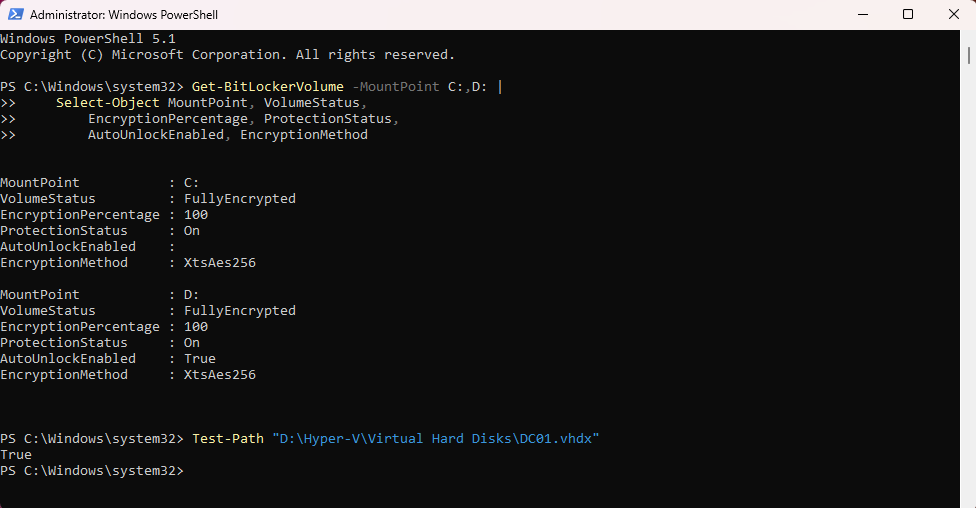

**Result:** Hyper-V storage encryption was completed successfully. Automatic unlocking remained functional after a host restart, and the domain controller's virtual hard disk remained accessible.

### Security Considerations

Automatic unlocking improves operational availability but introduces a dependency on the security of the Windows operating system volume.

An attacker with sufficient access to an already-unlocked host may also access the automatically unlocked data volume.

The configuration therefore relies on layered controls, including TPM-backed operating system encryption, restricted administrative access, and independent recovery credentials.

## Offline Backup Security — E:

ARGUS uses an external 2 TB Seagate hard drive labeled `ARGUS-BACKUP` for offline recovery storage.

The drive contains a Hyper-V export of DC01 and is normally disconnected from the host to reduce exposure to ransomware, accidental modification, and other threats affecting online storage.

### DC01 Hyper-V Export

A Hyper-V export of DC01 was created before encrypting the internal host volumes.

The export is stored at:

```text

E:\Hyper-V-Exports\DC01

```

The export includes the virtual machine configuration and virtual hard disk files.

The exported VHDX was checked using `Test-VHD`, which returned `True`.

This established that Hyper-V recognized the exported virtual disk as valid. A complete VM restoration test has not yet been performed.

### BitLocker To Go Configuration

The external backup volume was encrypted using BitLocker with XTS-AES-256.

Unlike the internal drives, E: uses a password protector because it must remain independently accessible when disconnected from ARGUS.

A separate 48-digit recovery password was also configured.

The encryption process was initiated using:

```powershell

$BackupPassword = Read-Host "Enter BitLocker unlock password for ARGUS-BACKUP" -AsSecureString

Enable-BitLocker `

    -MountPoint "E:" `

    -PasswordProtector `

    -Password $BackupPassword `

    -EncryptionMethod XtsAes256 `

    -ErrorAction Stop

Add-BitLockerKeyProtector `

    -MountPoint "E:" `

    -RecoveryPasswordProtector `

    -ErrorAction Stop

```

The unlock password and recovery password were stored securely outside ARGUS.

### Encryption and Protector Validation

BitLocker status was inspected using:

```powershell

Get-BitLockerVolume -MountPoint "E:" |

    Select-Object MountPoint, VolumeStatus,

        EncryptionPercentage, ProtectionStatus, EncryptionMethod

```

Key protector types were verified without exposing recovery credentials:

```powershell

(Get-BitLockerVolume -MountPoint "E:").KeyProtector |

    Select-Object KeyProtectorType

```

Final verification confirmed:

| Property | Verified Result |
|---|---|
| VolumeStatus | `FullyEncrypted` |
| EncryptionPercentage | `100` |
| ProtectionStatus | `On` |
| EncryptionMethod | `XtsAes256` |
| Key Protectors | `Password`, `RecoveryPassword` |

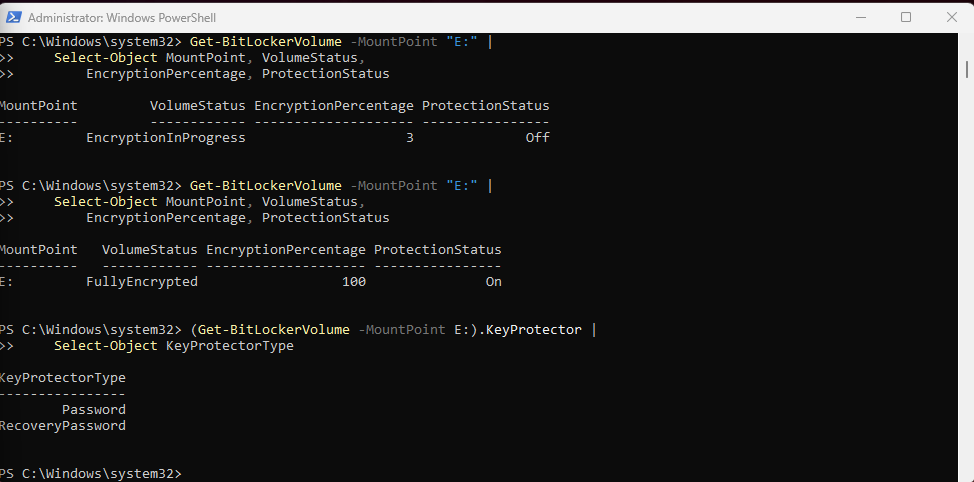

### Password Unlock and Offline Isolation

After encryption completed, the external backup drive was disconnected and reconnected to ARGUS.

Windows required the configured BitLocker unlock password before allowing access to the encrypted volume.

The password-based unlock succeeded, confirming that the backup drive remained accessible using its intended authentication method.

During final removal, Windows initially reported that the device was in use. Locking the BitLocker volume allowed the drive to be safely ejected.

The drive was then disconnected for offline storage.

**Result:** The external backup drive was fully encrypted, password-unlock tested, and safely isolated from the host.

## Post-Encryption Domain Controller Validation

After C: and D: were encrypted and the host successfully restarted, DC01 was started from Hyper-V.

The purpose of this test was to verify that host-level encryption had not disrupted the virtual machine's critical enterprise services.

### Active Directory and DNS Services

Inside DC01, the service states were checked:

```powershell

Get-Service NTDS,DNS |

    Select-Object Name, Status

```

Both services reported `Running`.

### Domain Controller Health

The following diagnostic tests were executed:

```powershell

dcdiag /test:Advertising /test:DNS

```

The diagnostic output confirmed successful connectivity, domain controller advertising, and DNS validation.

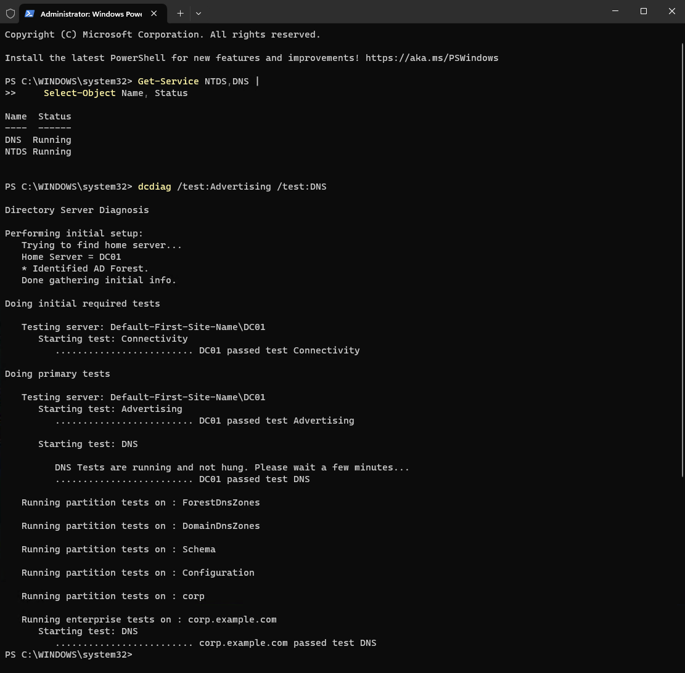

**Result:** DC01 started successfully from the encrypted Hyper-V storage volume, and its Active Directory Domain Services and DNS services passed the selected health checks.

## Backup and Recovery Limitations

The completed validation establishes that:

- The DC01 Hyper-V export exists on the external backup drive.

- The exported VHDX passed the `Test-VHD` validation check.

- The backup drive is fully encrypted and password-protected.

- The backup drive was successfully unlocked after reconnection.

- DC01 operates normally from the encrypted internal storage volume.

However, a full disaster-recovery test has not yet been completed.

Future recovery testing should include importing the exported VM into an isolated test environment, verifying that Windows Server starts, and confirming Active Directory and DNS functionality.

Until that testing is completed, the export should be considered an available backup rather than a fully validated restoration procedure.

## Security Validation Summary

The ARGUS BitLocker deployment was completed and validated across the operating system, Hyper-V storage, and external backup volumes.

### Final Encryption Configuration

| Volume | Encryption | Protection | Unlock Method | Validation |
|---|---|---|---|---|
| C: | XTS-AES-256 | On | TPM | Reboot successful |
| D: | XTS-AES-256 | On | Auto-unlock | Reboot and VHDX access successful |
| E: | XTS-AES-256 | On | Password | Disconnect and reconnect test successful |

All three volumes reached `FullyEncrypted` status with `100` percent encryption completed.

Independent recovery-password protectors were configured for each volume.

### Completed Security Checks

- [x] TPM presence and readiness verified

- [x] UEFI Secure Boot confirmed enabled

- [x] Windows Recovery Environment confirmed enabled

- [x] Internal storage health verified

- [x] Operating system volume encrypted

- [x] Operating system recovery protector configured

- [x] Operating system reboot validation completed

- [x] Hyper-V storage volume encrypted

- [x] Hyper-V storage automatic unlocking configured

- [x] Internal drive encryption verified after reboot

- [x] External backup volume encrypted

- [x] External backup password unlock tested

- [x] External backup drive safely disconnected

- [x] DC01 virtual hard disk accessibility verified

- [x] DC01 Active Directory and DNS service checks passed

- [x] Recovery credentials excluded from public documentation

### Remaining Validation

- [ ] Perform an isolated restoration test of the DC01 Hyper-V export

- [ ] Verify restored domain controller startup and service health

- [ ] Document the full backup restoration procedure

- [ ] Establish a recurring backup and recovery testing schedule

## Lessons Learned

This implementation demonstrated several important principles of enterprise endpoint and infrastructure security.

**Encryption at rest:** BitLocker protects stored data against unauthorized offline access, but does not replace operating system access controls or endpoint security.

**Recovery planning:** Encryption must be accompanied by secure recovery credential storage and a tested recovery process.

**Operational continuity:** Automatic unlocking allows the Hyper-V storage volume to remain encrypted without requiring manual unlocking after every normal host restart.

**Layered security:** TPM-backed encryption, administrative account separation, offline backup storage, and service validation provide complementary controls.

**Validation:** Encryption status alone is not sufficient evidence of a successful deployment. Host restarts, storage accessibility, and application service health must also be tested.

## Future Improvements

The next infrastructure security activities will focus on recovery testing, backup repeatability, and additional administrative controls.

Potential improvements include:

1. Performing a complete Hyper-V restore test in an isolated environment.

2. Developing a documented backup and restoration runbook.

3. Automating periodic checks of BitLocker protection status.

4. Establishing a recurring offline backup schedule.

5. Reviewing additional host security and audit policies.

## Conclusion

ARGUS now uses BitLocker XTS-AES-256 encryption across its operating system, Hyper-V storage, and external backup volumes.

The deployment was validated through encryption status checks, host restarts, automatic unlocking, password-based external drive access, virtual disk accessibility, and domain controller service diagnostics.

The implementation provides a documented foundation for protecting the Windows enterprise homelab while supporting future disaster-recovery and security administration exercises.
