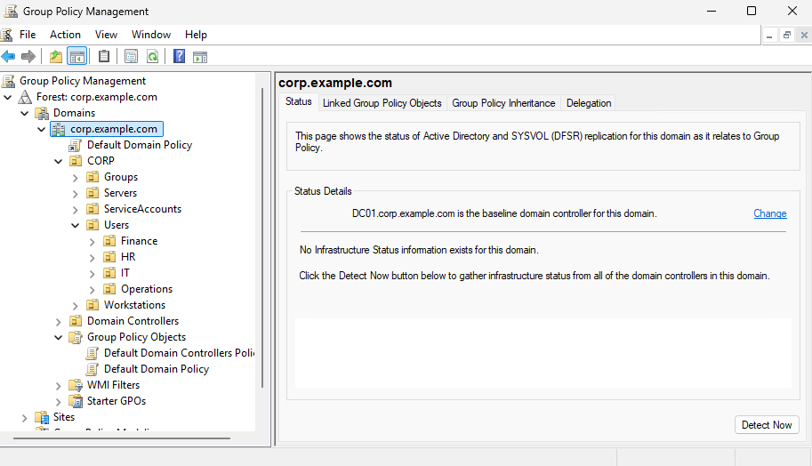
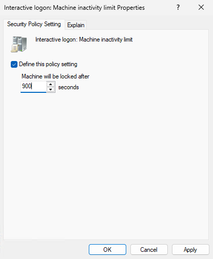
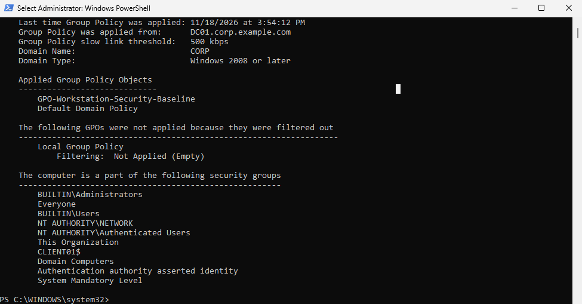
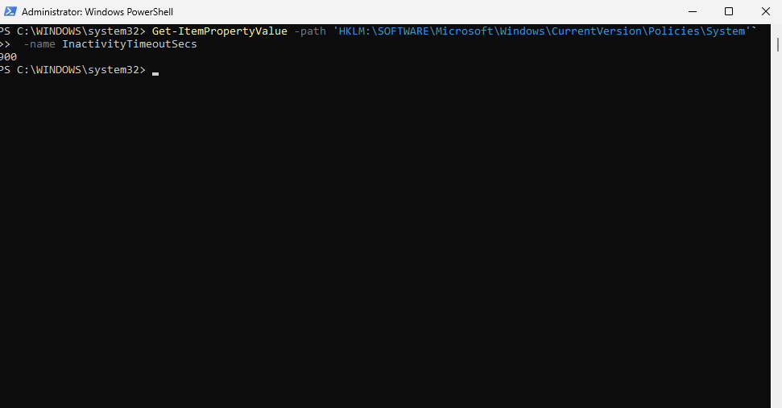

# Workstation Security Baseline — Group Policy

## Overview

This exercise demonstrates the deployment and validation of a centralized workstation security policy using Active Directory Group Policy in the ARGUS Windows enterprise homelab.

A custom Group Policy Object (GPO) was created on DC01 and linked to the Workstations organizational unit (OU). The policy configures Windows to automatically lock an interactive user session after 15 minutes of inactivity.

The policy was deployed to CLIENT01, a domain-joined Windows 11 Enterprise workstation, and validated using Group Policy reporting and Windows Registry inspection.

## Lab Environment

| Component | Configuration |
|---|---|
| Hypervisor | Microsoft Hyper-V on ARGUS |
| Domain Controller | DC01 — Windows Server 2025 |
| Client Workstation | CLIENT01 — Windows 11 Enterprise |
| Active Directory Domain | corp.example.com |
| Target OU | CORP/Workstations |
| Group Policy Object | GPO-Workstation-Security-Baseline |
| Test User | CORP\amorgan |

## Security Objective

Enforce a consistent workstation inactivity timeout through centralized Group Policy management.

The policy requires Windows to lock an interactive session after 900 seconds (15 minutes) of inactivity, reducing the risk of unauthorized access to unattended workstations.

This configuration applies at the computer level, independent of the domain user signing in.

## Group Policy Implementation

### 1. Create and Link the GPO

Using Group Policy Management (`gpmc.msc`) on DC01, a custom Group Policy Object was created with the following configuration:

| Property | Value |
|---|---|
| GPO Name | GPO-Workstation-Security-Baseline |
| Domain | corp.example.com |
| Linked OU | CORP/Workstations |
| Link Enabled | Yes |
| GPO Status | Enabled |
| Enforced | No |
| Link Order | 1 |

The GPO was created using **Create a GPO in this domain, and Link it here** on the Workstations OU.

CLIENT01 was verified as a computer object within the targeted OU using Active Directory Users and Computers (`dsa.msc`).

The default domain policies were left unchanged to maintain separation between Microsoft-provided baseline policies and custom workstation configurations.



### 2. Configure the Inactivity Timeout

The custom GPO was edited using Group Policy Management Editor.

Configuration path:

```text
Computer Configuration
→ Policies
→ Windows Settings
→ Security Settings
→ Local Policies
→ Security Options
```

Policy: **Interactive logon: Machine inactivity limit**

| Setting | Configured Value |
|---|---|
| Define this policy setting | Enabled |
| Machine inactivity limit | 900 seconds |
| Equivalent timeout | 15 minutes |

The setting was applied and saved on DC01.

Because this setting resides under Computer Configuration, it applies to computers within the GPO's scope rather than targeting individual user accounts.



## Deployment and Validation

### 3. Refresh Group Policy on CLIENT01

CLIENT01 was started and a domain session was established using the standard user account `CORP\amorgan`.

Windows PowerShell was used to initiate a manual Group Policy refresh:

```powershell
gpupdate /force
```

The command returned:

```text
Computer Policy update has completed successfully.
User Policy update has completed successfully.
```

This confirmed that Windows completed both computer and user policy refresh operations without reporting errors.

A successful policy refresh alone does not establish that a specific GPO was applied. Additional verification was performed.

### 4. Verify Applied Group Policy Objects

An elevated Windows PowerShell session was opened on CLIENT01 using authorized administrator credentials.

The following command was executed:

```powershell
gpresult /r /scope computer
```

The resulting report identified the following applied policies:

```text
Applied Group Policy Objects
----------------------------
    GPO-Workstation-Security-Baseline
    Default Domain Policy
```

This confirmed that CLIENT01 processed the custom workstation security GPO and the existing Default Domain Policy.



### 5. Verify the Effective Registry Configuration

The inactivity timeout was independently verified by querying the corresponding Windows Registry value on CLIENT01.

```powershell
Get-ItemPropertyValue -Path 'HKLM:\SOFTWARE\Microsoft\Windows\CurrentVersion\Policies\System' -Name InactivityTimeoutSecs
```

Observed output:

```text
900
```

The Registry value `InactivityTimeoutSecs` represents the configured machine inactivity timeout in seconds.

The returned value of `900` confirmed that the intended 15-minute inactivity limit was present in CLIENT01's machine-wide security configuration.



### Validation Summary

| Validation Check | Result |
|---|---|
| CLIENT01 located in target Workstations OU | Passed |
| GPO created and linked to Workstations OU | Passed |
| Computer Group Policy refresh | Passed |
| Custom GPO listed in gpresult | Passed |
| Registry inactivity timeout equals 900 seconds | Passed |
| Automatic workstation lock after 15 minutes | Passed |

The deployment and configuration validation were successful.

## Functional Validation

Following successful Group Policy application and Registry verification, CLIENT01 was left unattended during an interactive domain user session.

After the configured inactivity period, Windows automatically locked the workstation and required authentication to resume the session.

**Result: Passed**

This confirmed that the deployed security policy was functioning as intended, beyond merely being present in the Registry.

## Lessons Learned

This exercise demonstrated several core enterprise Windows administration concepts:

- Group Policy Objects can centrally manage security configurations across domain-joined workstations.
- GPO links determine which Active Directory sites, domains, or organizational units receive a policy.
- Computer Configuration settings apply independently of the signed-in domain user.
- A successful `gpupdate /force` does not independently confirm that a specific GPO was applied.
- `gpresult /r /scope computer` identifies the GPOs processed by a workstation.
- Windows Registry inspection can independently verify effective machine-level policy settings.
- Functional testing provides additional assurance that deployed security controls behave as intended.
- Standard user accounts and administrative accounts have different privileges when inspecting system-level policy information.

## Conclusion

The GPO-Workstation-Security-Baseline policy was successfully deployed from DC01 to CLIENT01 through Active Directory Group Policy.

The configured 900-second machine inactivity limit was verified through Group Policy reporting, Registry inspection, and functional testing.

This exercise establishes a foundation for future workstation security policies, centralized configuration management, and Group Policy troubleshooting within the ARGUS enterprise homelab.