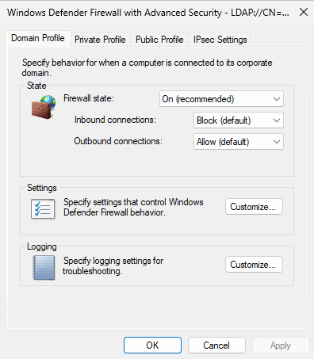
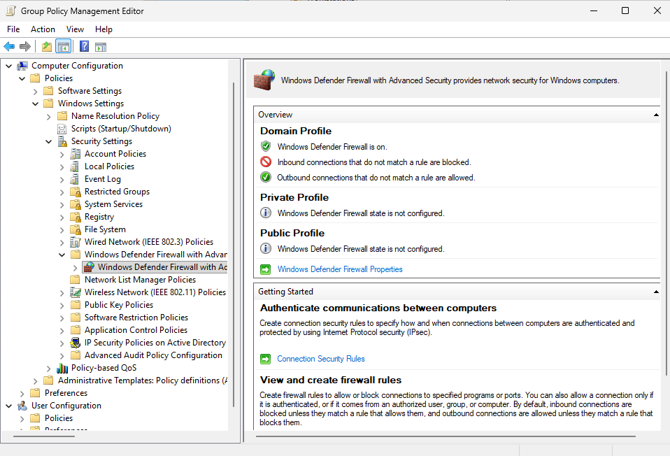
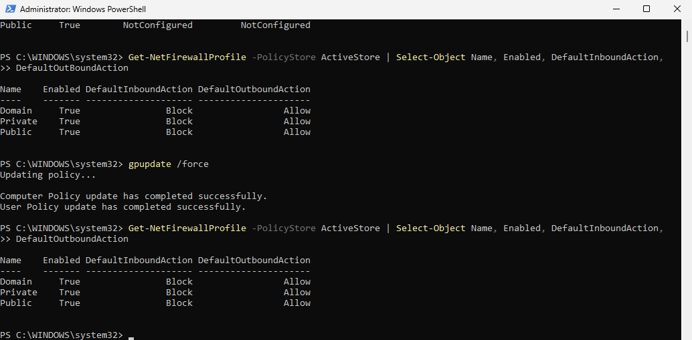
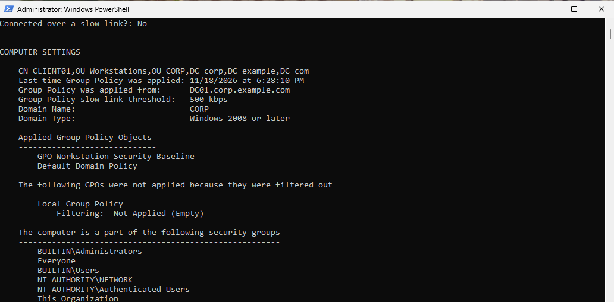
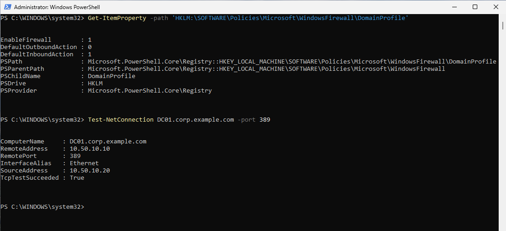

# Windows Defender Firewall - Group Policy Deployment and Validation

## Overview

This document details the configuration, deployment, and validation of Windows Defender Firewall settings through Active Directory Group Policy within the ARGUS Windows Enterprise Homelab.

The existing GPO-Workstation-Security-Baseline Group Policy Object (GPO) was extended to centrally manage the Windows Defender Firewall Domain profile for domain-joined workstations.

The configuration explicitly enables Windows Defender Firewall, blocks inbound connections that do not match an applicable allow rule, and permits outbound connections unless an applicable rule blocks them.

The policy was deployed to CLIENT01, a Windows 11 Enterprise workstation joined to the corp.example.com Active Directory domain. Deployment was validated through Group Policy reporting, PowerShell firewall inspection, Windows Registry verification, and network connectivity testing.

## Security Objective

The objective of this exercise was to establish centrally managed, consistent firewall security settings for domain-connected workstations.

The implementation was designed to:

- Enforce Windows Defender Firewall for the Domain network profile through Active Directory Group Policy.

- Block unsolicited inbound connections by default while preserving explicitly permitted traffic.

- Allow outbound connections by default to support normal workstation and domain operations.

- Maintain connectivity between CLIENT01 and the domain controller, DC01.

- Verify both the effective firewall configuration and the presence of administrator-managed policy settings.

- Document the deployment and validation process as a reproducible enterprise security administration exercise.

This configuration follows a default-deny approach for unsolicited inbound traffic while maintaining normal outbound connectivity. It establishes a foundation for future workstation firewall rule management and additional endpoint security controls.

## Lab Environment

The firewall policy deployment was performed within the ARGUS Windows Enterprise Homelab using the following infrastructure:

| Component | Configuration |
|---|---|
| Hypervisor Host | ARGUS — Windows 11 Pro with Hyper-V |
| Domain Controller | DC01 — Windows Server 2025 |
| Active Directory Domain | `corp.example.com` |
| Domain Controller IP | `10.50.10.10` |
| Domain-Joined Workstation | CLIENT01 — Windows 11 Enterprise |
| Workstation IP | `10.50.10.20` |
| Virtual Network | Hyper-V `LAB-Internal` |
| Target Organizational Unit | `CORP/Workstations` |
| Group Policy Object | `GPO-Workstation-Security-Baseline` |

The existing GPO was linked to the Workstations organizational unit and had previously been validated through deployment of a 900-second workstation inactivity lock policy.

The Windows Defender Firewall configuration was added to this existing GPO to extend the workstation security baseline.

## Initial Firewall Baseline

Before modifying Group Policy, the existing firewall configuration on CLIENT01 was inspected using PowerShell.

The initial command retrieved firewall profile settings from the local persistent policy store:

```powershell
Get-NetFirewallProfile | Select-Object Name, Enabled, DefaultInboundAction, DefaultOutboundAction
```

All three firewall profiles — Domain, Private, and Public — reported `Enabled = True`. However, their default inbound and outbound actions were displayed as `NotConfigured`.

This did not indicate that the firewall was inactive. Rather, the queried configuration did not explicitly define those default actions.

To inspect the effective firewall configuration, the following command was executed:

```powershell
Get-NetFirewallProfile -PolicyStore ActiveStore | Select-Object Name, Enabled, DefaultInboundAction, DefaultOutboundAction
```

The effective configuration was:

| Profile | Enabled | Default Inbound Action | Default Outbound Action |
|---|---|---|---|
| Domain | True | Block | Allow |
| Private | True | Block | Allow |
| Public | True | Block | Allow |

These results established that Windows Defender Firewall was already active and enforcing the expected default behavior.

The purpose of the subsequent Group Policy deployment was therefore not to change the workstation's effective firewall behavior, but to explicitly enforce the Domain profile configuration through centralized administrative policy.

This baseline provided a reference for comparing firewall behavior before and after Group Policy deployment.

## Group Policy Configuration

### GPO Selection and Scope

The existing `GPO-Workstation-Security-Baseline` was modified using Group Policy Management on DC01.

The GPO was already linked to the `CORP/Workstations` organizational unit, which contains the domain-joined workstation CLIENT01.

Rather than creating a separate firewall GPO, the configuration was incorporated into the existing workstation security baseline to consolidate related endpoint hardening policies.

The Group Policy Management Editor was opened using the following navigation path:

**Computer Configuration → Policies → Windows Settings → Security Settings → Windows Defender Firewall with Advanced Security → Windows Defender Firewall with Advanced Security**

The **Windows Defender Firewall Properties** dialog was then opened, and the **Domain Profile** tab was selected.

### Domain Firewall Configuration

The following settings were explicitly configured:

| Setting | Configured Value |
|---|---|
| Firewall state | On (recommended) |
| Inbound connections | Block (default) |
| Outbound connections | Allow (default) |

These settings establish the following behavior:

- **Firewall enabled:** Windows Defender Firewall is enabled for the Domain network profile.
- **Inbound connections blocked by default:** Incoming connections are blocked unless an applicable firewall rule permits them.
- **Outbound connections allowed by default:** Outbound connections are permitted unless an applicable rule explicitly blocks them.

The **Private** and **Public** firewall profiles were intentionally left as `Not configured` within this GPO.

This exercise focused specifically on enforcing the Domain firewall profile for domain-connected workstations.

### Configuration Evidence

The following screenshot shows the configured Domain Profile settings in the Windows Defender Firewall Properties dialog.



After applying the configuration, the Group Policy Management Editor displayed the Domain firewall as enabled, with inbound connections blocked and outbound connections allowed by default.



These screenshots document the settings configured on DC01 before deployment validation on CLIENT01.

## Group Policy Deployment and Validation

### Policy Deployment to CLIENT01

After configuring the Domain firewall profile on DC01, the updated Group Policy was deployed to CLIENT01.

An elevated PowerShell session was opened on CLIENT01, and the following command was executed:

```powershell
gpupdate /force
```

The command completed successfully for both Computer Policy and User Policy.

The `/force` argument instructs Windows to reapply all applicable Group Policy settings, including settings that have not changed since the previous refresh.

Because Windows Defender Firewall settings are configured under **Computer Configuration**, they apply to the workstation independently of the currently signed-in domain user.

### Effective Firewall Configuration Verification

Following the successful Group Policy refresh, the effective firewall configuration was inspected using PowerShell:

```powershell
Get-NetFirewallProfile -PolicyStore ActiveStore | Select-Object Name, Enabled, DefaultInboundAction, DefaultOutboundAction
```

The following results were observed:

| Firewall Profile | Enabled | Default Inbound Action | Default Outbound Action |
|---|---|---|---|
| Domain | True | Block | Allow |
| Private | True | Block | Allow |
| Public | True | Block | Allow |

The Domain profile retained the expected security configuration:

- Windows Defender Firewall enabled.
- Unmatched inbound connections blocked by default.
- Outbound connections allowed by default.

The effective configuration matched the initial baseline. This was expected because the GPO was designed to explicitly enforce existing secure behavior rather than introduce a different firewall configuration.

The Private and Public profiles remained operational but were not explicitly configured through this GPO.



The `ActiveStore` results confirmed the workstation's effective firewall behavior. However, this command alone did not identify which policy source supplied the settings.

### Applied Group Policy Verification

To verify that CLIENT01 had processed the workstation security baseline GPO, the following command was executed from an elevated PowerShell session:

```powershell
gpresult /r /scope computer
```

The resulting report confirmed that:

- CLIENT01 was joined to the `corp.example.com` domain.
- CLIENT01 was located in the `CORP/Workstations` organizational unit.
- DC01 was the domain controller supplying Group Policy information.
- `GPO-Workstation-Security-Baseline` appeared under **Applied Group Policy Objects**.
- The Default Domain Policy was also applied.



This confirmed that CLIENT01 had successfully processed the intended workstation security GPO.

Together, the effective firewall inspection and Group Policy reporting established that the workstation was operating with the expected firewall configuration and had applied the relevant domain GPO.

Additional registry-level verification was performed to confirm that the expected firewall policy values were present on CLIENT01.

### Windows Registry Policy Verification

To further validate the deployed firewall configuration, the Windows Registry was inspected on CLIENT01 using an elevated PowerShell session.

The following command retrieved the administrator-managed Domain firewall policy settings:

```powershell
Get-ItemProperty -Path 'HKLM:\SOFTWARE\Policies\Microsoft\WindowsFirewall\DomainProfile'
```

The following values were returned:

| Registry Property | Observed Value | Interpretation |
|---|---|---|
| `EnableFirewall` | `1` | Domain firewall enabled |
| `DefaultInboundAction` | `1` | Block inbound connections by default |
| `DefaultOutboundAction` | `0` | Allow outbound connections by default |

These values matched the configuration defined in `GPO-Workstation-Security-Baseline` on DC01.

The registry path is located beneath `HKEY_LOCAL_MACHINE\SOFTWARE\Policies`, which Windows uses to store administrator-managed policy settings.

The presence of these values provided additional evidence that the intended Domain firewall policy configuration had been delivered to CLIENT01.

Combined with the successful `gpresult` verification and effective firewall inspection, this established a consistent relationship between the configured Group Policy settings, the workstation's policy registry values, and its effective firewall behavior.

### Domain Controller Connectivity Testing

After confirming the firewall configuration, a network connectivity test was performed to verify that CLIENT01 could still communicate with its domain controller.

The following PowerShell command was executed:

```powershell
Test-NetConnection DC01.corp.example.com -Port 389
```

The command tested TCP connectivity to port `389`, commonly used by Active Directory for LDAP communication.

The following results were observed:

| Property | Result |
|---|---|
| Destination Hostname | `DC01.corp.example.com` |
| Destination IP Address | `10.50.10.10` |
| Source IP Address | `10.50.10.20` |
| Destination Port | TCP 389 |
| `TcpTestSucceeded` | `True` |

The successful test confirmed that CLIENT01 could resolve the domain controller's hostname and establish a TCP connection to its LDAP service after the firewall policy was applied.

This test verified network reachability to the LDAP service. It did not perform a complete LDAP authentication or directory query.

The result demonstrated that the deployed firewall configuration preserved this essential Active Directory communication path.

### Registry and Connectivity Evidence

The following screenshot captures the Domain firewall policy registry values and the successful TCP 389 connectivity test.



The combined validation results demonstrated that the Domain firewall policy was present on CLIENT01, the effective firewall configuration matched the intended security baseline, and connectivity to DC01 remained available.

## Troubleshooting

### GroupPolicyRSoP Query Failure

During validation, an attempt was made to retrieve the resultant Group Policy firewall configuration directly using PowerShell:

```powershell
Get-NetFirewallProfile -PolicyStore GroupPolicyRSoP | Select-Object Name, Enabled, DefaultInboundAction, DefaultOutboundAction
```

The command returned the following error:

```text
Get-NetFirewallProfile : The network path was not found.
Windows System Error 53
```

This prevented direct inspection of the firewall configuration through the `GroupPolicyRSoP` policy store.

The error did not establish that Group Policy deployment had failed. It indicated that this particular method of retrieving firewall policy information was unsuccessful.

The underlying cause of Error 53 was not conclusively identified during this exercise.

### Alternative Validation Methods

Rather than modifying the firewall configuration or assuming the deployment had failed, several independent checks were performed:

1. **Group Policy processing:** `gpupdate /force` completed successfully on CLIENT01.
2. **GPO application:** `gpresult /r /scope computer` confirmed that `GPO-Workstation-Security-Baseline` was applied.
3. **Effective firewall configuration:** `Get-NetFirewallProfile -PolicyStore ActiveStore` returned the expected Domain profile settings.
4. **Policy registry inspection:** The registry contained `EnableFirewall = 1`, `DefaultInboundAction = 1`, and `DefaultOutboundAction = 0`.
5. **Network connectivity:** `Test-NetConnection DC01.corp.example.com -Port 389` returned `TcpTestSucceeded : True`.

These results provided complementary evidence that the intended firewall configuration was present, the workstation had processed the applicable GPO, and connectivity to the domain controller remained available.

The `GroupPolicyRSoP` query failure remained unresolved but did not prevent completion of the primary deployment and validation objectives.

## Lessons Learned

### Understanding Firewall Policy Stores

Windows Defender Firewall supports multiple policy stores representing different sources or views of firewall configuration.

The `-PolicyStore` parameter identifies which store a PowerShell cmdlet should query.

The following distinctions were demonstrated:

| Policy Store | Purpose |
|---|---|
| `PersistentStore` | Locally stored firewall configuration |
| `ActiveStore` | Effective firewall configuration after applicable policies are processed |
| `GroupPolicyRSoP` | Resultant firewall settings associated with Group Policy processing |

Understanding these distinctions is important when determining whether a security setting is locally configured, centrally managed, or currently effective.

### Configuration Versus Enforcement

CLIENT01 already had its Domain firewall enabled with inbound connections blocked and outbound connections allowed before the GPO modification.

The purpose of the exercise was to explicitly define these settings through Active Directory Group Policy.

The unchanged effective configuration after deployment was therefore expected and did not indicate that the policy had failed.

### Independent Verification

A successful Group Policy refresh alone does not prove that every individual security setting has been applied correctly.

Combining Group Policy reporting, effective configuration inspection, registry verification, and connectivity testing provided stronger evidence than relying on any single diagnostic command.

### Preserving Domain Connectivity

Firewall policy changes can unintentionally disrupt network services if inbound and outbound restrictions are configured without considering existing communication requirements.

By retaining the default outbound allow behavior and avoiding an unconditional inbound block, the workstation maintained connectivity to its domain controller.

The successful TCP 389 test verified that an important Active Directory communication path remained accessible after deployment.

### Troubleshooting Without Unnecessary Configuration Changes

The `GroupPolicyRSoP` error demonstrated the importance of distinguishing between a diagnostic tool failure and an actual security configuration failure.

Rather than immediately changing working firewall settings, alternative verification methods were used to evaluate the deployment.

This approach reduced unnecessary changes and preserved the workstation's functioning configuration while collecting additional diagnostic evidence.

## Conclusion

The Windows Defender Firewall Group Policy deployment was successfully completed and validated within the ARGUS Windows Enterprise Homelab.

The existing `GPO-Workstation-Security-Baseline` was extended to centrally enforce the Domain firewall profile on CLIENT01, a Windows 11 Enterprise workstation joined to the `corp.example.com` Active Directory domain.

The implemented configuration explicitly enabled Windows Defender Firewall, blocked unmatched inbound connections by default, and allowed outbound connections by default.

Validation confirmed that:

- CLIENT01 successfully refreshed and applied the workstation security GPO.
- The effective Domain firewall configuration matched the intended security baseline.
- The expected administrator-managed firewall settings were present in the Windows Registry.
- TCP connectivity between CLIENT01 and DC01 remained functional on port 389.
- The Private and Public firewall profiles were not explicitly modified by this GPO.

Although the `GroupPolicyRSoP` query encountered Windows System Error 53, alternative verification methods provided sufficient evidence to validate the deployment. The underlying cause of the query failure remains an open troubleshooting item.

This exercise demonstrated practical experience with Active Directory Group Policy administration, Windows Defender Firewall configuration, PowerShell-based security verification, registry inspection, and network connectivity testing.

Together with the previously implemented 900-second workstation inactivity lock, the firewall configuration establishes a growing, centrally managed workstation security baseline.

Future exercises may extend this baseline through additional endpoint security policies, more granular firewall rules, and further validation of Group Policy enforcement across multiple domain-joined workstations.