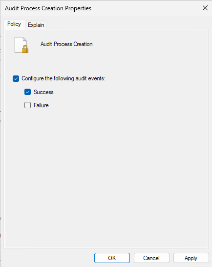
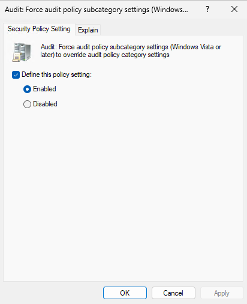
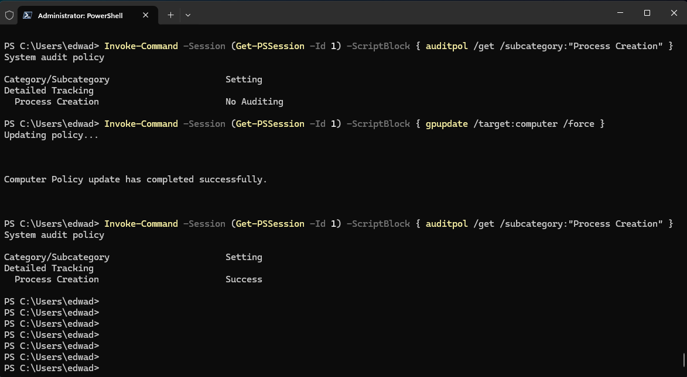
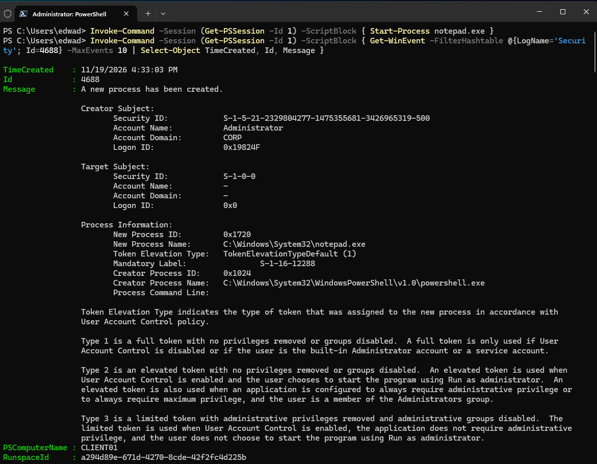
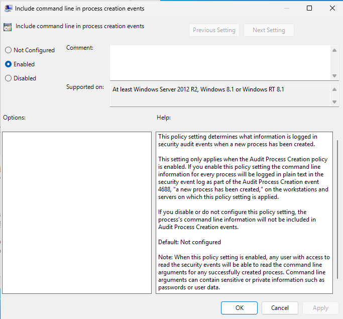
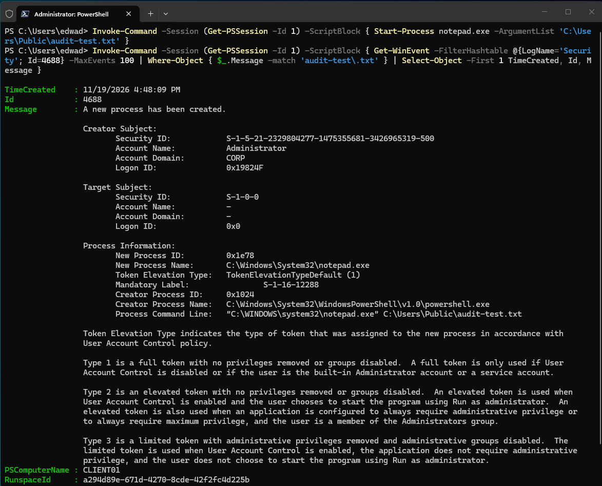

# Windows Security Auditing and Process Creation Monitoring

## Objective

Configure and validate centralized Windows Security auditing through Active Directory Group Policy in a domain-joined Windows 11 Enterprise environment.

This exercise focuses on:

- Establishing a baseline of existing Windows audit policies.
- Enabling Advanced Audit Policy process creation auditing.
- Configuring advanced audit policy precedence.
- Enabling command-line inclusion in process creation events.
- Deploying and validating the configuration on a domain-joined workstation.
- Generating controlled security events and analyzing Windows Event IDs 4624, 4672, and 4688.
- Correlating authentication, privilege assignment, and process execution using Windows Logon IDs.

The goal is to demonstrate how centrally managed security policies can improve endpoint visibility and support security operations and incident investigations.

## Lab Environment

| Component | Configuration |
|---|---|
| Hyper-V Host | ARGUS — Windows 11 Pro |
| Domain Controller | DC01 — Windows Server 2025 |
| Domain-Joined Workstation | CLIENT01 — Windows 11 Enterprise |
| Active Directory Domain | corp.example.com |
| Domain NetBIOS Name | CORP |
| Organizational Unit | CORP/Workstations |
| Group Policy Object | GPO-Workstation-Security-Baseline |
| Virtual Network | LAB-Internal |
| Administrative Tools | Group Policy Management, PowerShell, auditpol, Get-WinEvent |
| Exercise Date | November 19, 2026 |

The existing workstation security baseline GPO was extended to include Windows Security auditing controls. The GPO is linked to the Workstations OU containing CLIENT01.

## Baseline Audit Policy Assessment

Before modifying Group Policy, the existing Windows audit configuration was examined on CLIENT01.

```powershell
auditpol /get /category:*
```

The output was captured to a text file for review.

```powershell
auditpol /get /category:* > C:\Users\Public\audit-baseline.txt
```

### Baseline Findings

Selected audit subcategories were configured as follows:

| Audit Subcategory | Baseline Setting |
|---|---|
| Logon | Success and Failure |
| Logoff | Success |
| Account Lockout | Success |
| Special Logon | Success |
| Audit Policy Change | Success |
| User Account Management | Success |
| Security Group Management | Success |
| Process Creation | No Auditing |
| File System | No Auditing |
| Registry | No Auditing |

Successful and failed logon auditing was already enabled. However, process creation auditing was disabled, limiting visibility into executable activity on CLIENT01.

The Process Creation subcategory was independently verified:

```powershell
auditpol /get /subcategory:"Process Creation"
```

**Observed result:**

```text
Category/Subcategory                      Setting
Detailed Tracking
  Process Creation                        No Auditing
```

This established the baseline for evaluating the subsequent Group Policy deployment.

## PowerShell Direct Administration

During the assessment, Hyper-V Basic Session limitations prevented convenient clipboard sharing between CLIENT01 and the ARGUS host.

PowerShell Direct was used to establish a remote administrative session through Hyper-V's VMBus transport.

On ARGUS:

```powershell
New-PSSession -VMName CLIENT01 -Credential (Get-Credential)
```

The session was successfully established using authorized administrative credentials.

The audit baseline file was transferred from CLIENT01 to ARGUS:

```powershell
Copy-Item -FromSession (Get-PSSession -Id 1) -Path 'C:\Users\Public\audit-baseline.txt' -Destination 'C:\Users\Public\audit-baseline.txt'
```

PowerShell Direct provided remote command execution and file transfer without requiring conventional network-based PowerShell remoting or Enhanced Session Mode.

This approach also allowed Windows Security events to be queried directly from ARGUS throughout the exercise.

## Advanced Audit Policy Configuration

The existing `GPO-Workstation-Security-Baseline` was edited using Group Policy Management on DC01.

### Enable Process Creation Auditing

**Policy location:**

Computer Configuration → Policies → Windows Settings → Security Settings → Advanced Audit Policy Configuration → Audit Policies → Detailed Tracking → Audit Process Creation

**Configuration:**

| Setting | Value |
|---|---|
| Configure the following audit events | Enabled |
| Success | Selected |
| Failure | Not selected |

Enabling successful process creation auditing allows Windows to generate Security Event ID **4688** when processes are created.



### Configure Advanced Audit Policy Precedence

**Policy location:**

Computer Configuration → Policies → Windows Settings → Security Settings → Local Policies → Security Options

**Policy:**

Audit: Force audit policy subcategory settings (Windows Vista or later) to override audit policy category settings

**Configuration:** Enabled

This setting ensures advanced audit subcategory policies take precedence over legacy category-level audit settings.



## Group Policy Deployment and Verification

After configuring the auditing policies, CLIENT01's computer policies were refreshed remotely from ARGUS.

```powershell
Invoke-Command -Session (Get-PSSession -Id 1) -ScriptBlock { gpupdate /target:computer /force }
```

**Observed result:**

```text
Updating policy...

Computer Policy update has completed successfully.
```

The effective auditing configuration was then queried:

```powershell
Invoke-Command -Session (Get-PSSession -Id 1) -ScriptBlock { auditpol /get /subcategory:"Process Creation" }
```

**Observed result:**

```text
Category/Subcategory                      Setting
Detailed Tracking
  Process Creation                        Success
```

The effective audit configuration changed from `No Auditing` to `Success` following the Group Policy refresh.



This verified that process creation auditing was enabled on CLIENT01.

## Process Creation Event Validation

A controlled process execution test was performed using Notepad.

```powershell
Invoke-Command -Session (Get-PSSession -Id 1) -ScriptBlock { Start-Process notepad.exe }
```

The Windows Security log was then queried for Event ID 4688:

```powershell
Invoke-Command -Session (Get-PSSession -Id 1) -ScriptBlock { Get-WinEvent -FilterHashtable @{LogName='Security'; Id=4688} -MaxEvents 10 | Select-Object TimeCreated, Id, Message }
```

### Observed Event 4688

| Field | Observed Value |
|---|---|
| Event ID | 4688 |
| Event Description | A new process has been created |
| Account | CORP\Administrator |
| New Process | C:\Windows\System32\notepad.exe |
| Creator Process | C:\Windows\System32\WindowsPowerShell\v1.0\powershell.exe |
| Logon ID | 0x19824F |
| New Process ID | 0x1720 |
| Process Command Line | Empty |

The event confirmed that Windows recorded the controlled Notepad execution and identified the originating PowerShell process.



Additional Event 4688 records were observed for Windows system components and administrative utilities, including `auditpol.exe`.

These findings confirmed that process creation auditing was collecting ongoing endpoint activity.

## Enable Command-Line Auditing

Although Event ID 4688 identified the executable and creator process, the initial event did not include command-line arguments.

To improve investigative visibility, an additional Group Policy setting was configured.

**Policy location:**

Computer Configuration → Policies → Administrative Templates → System → Audit Process Creation

**Policy:** Include command line in process creation events

**Configuration:** Enabled



### Deploy the Updated Policy

CLIENT01's computer policies were refreshed again:

```powershell
Invoke-Command -Session (Get-PSSession -Id 1) -ScriptBlock { gpupdate /target:computer /force }
```

The refresh completed successfully.

### Generate an Enriched Process Creation Event

Notepad was launched again, this time with a file path argument.

```powershell
Invoke-Command -Session (Get-PSSession -Id 1) -ScriptBlock { Start-Process notepad.exe -ArgumentList 'C:\Users\Public\audit-test.txt' }
```

The Security log was queried for Event ID 4688 records containing the test filename.

```powershell
Invoke-Command -Session (Get-PSSession -Id 1) -ScriptBlock { Get-WinEvent -FilterHashtable @{LogName='Security'; Id=4688} -MaxEvents 100 | Where-Object { $_.Message -match 'audit-test\.txt' } | Select-Object -First 1 TimeCreated, Id, Message }
```

**Observed process command line:**

```text
"C:\WINDOWS\system32\notepad.exe" C:\Users\Public\audit-test.txt
```

The event now included the executable path and supplied file argument.



### Registry Verification

The effective command-line auditing configuration was inspected through the Windows Registry:

```powershell
Invoke-Command -Session (Get-PSSession -Id 1) -ScriptBlock { Get-ItemProperty -Path 'HKLM:\SOFTWARE\Microsoft\Windows\CurrentVersion\Policies\System\Audit' }
```

**Observed value:**

```text
ProcessCreationIncludeCmdLine_Enabled : 1
```

This confirmed that the command-line inclusion setting was enabled on CLIENT01.

### Before-and-After Comparison

| Event 4688 Field | Initial Test | Command-Line Auditing Enabled |
|---|---|---|
| Process Name | notepad.exe | notepad.exe |
| Creator Process | powershell.exe | powershell.exe |
| Account | CORP\Administrator | CORP\Administrator |
| Process Command Line | Empty | Executable path and file argument |

Command-line inclusion provided additional context for investigating process execution.

**Security consideration:** Command-line arguments may contain passwords, authentication tokens, or other sensitive data. Access to Security logs and any centralized log collection platform should therefore be appropriately restricted.

## Security Event Correlation

Before enabling process creation auditing, existing authentication and privilege-assignment events were investigated.

### Event ID 4624 — Successful Logon

CLIENT01 recorded a successful logon for `CORP\Administrator`.

| Field | Observed Value |
|---|---|
| Event ID | 4624 |
| Timestamp | November 19, 2026, 3:12:45 PM |
| Account | CORP\Administrator |
| Logon Type | 2 — Interactive |
| Elevated Token | Yes |
| Logon ID | 0x19824F |

The timing and authentication context were consistent with the administrative PowerShell Direct session, although the event did not independently identify PowerShell Direct as its connection mechanism.

### Event ID 4672 — Special Privileges Assigned

A corresponding Event ID 4672 was identified with the same account and Logon ID.

Selected privileges included:

- SeSecurityPrivilege
- SeTakeOwnershipPrivilege
- SeLoadDriverPrivilege
- SeBackupPrivilege
- SeRestorePrivilege
- SeDebugPrivilege
- SeImpersonatePrivilege

The event confirmed that special privileges were assigned to the administrator's logon session.

### Event ID 4688 — Process Creation

The controlled Notepad execution was recorded under the same Logon ID:

`0x19824F`

This allowed three security events to be correlated:

| Event ID | Event Description | Correlation |
|---|---|---|
| 4624 | Successful logon | CORP\Administrator, Logon ID 0x19824F |
| 4672 | Special privileges assigned | Same account and Logon ID |
| 4688 | Process created | Same account and Logon ID |

The correlation established that the process creation event was associated with the previously identified privileged administrator logon session.

Windows Logon IDs are useful for connecting related events on the same computer within the same boot session.

## Security Analysis

This exercise demonstrated several important endpoint monitoring concepts.

**Centralized auditing:** Active Directory Group Policy can consistently configure auditing behavior across domain-joined workstations.

**Baseline assessment:** Existing audit configurations should be reviewed before implementing changes. CLIENT01 already recorded successful and failed logons, but process creation auditing was disabled.

**Effective policy verification:** Successful Group Policy refresh alone does not establish that a specific security setting was applied. The effective configuration must be verified.

**Process visibility:** Event ID 4688 provides information about executable launches, associated accounts, process identifiers, and creator processes.

**Command-line context:** Including process arguments can substantially improve the investigative value of process creation events.

**Event correlation:** Shared Logon IDs can connect authentication, privilege assignment, and process execution into a coherent sequence of activity.

**Event interpretation:** Administrative privileges and process creation events are not inherently malicious. Their significance depends on the account, process, execution context, and surrounding activity.

## Results

| Validation Objective | Result |
|---|---|
| Establish baseline audit policy | Passed |
| Configure Advanced Audit Policy through GPO | Passed |
| Enable advanced audit policy precedence | Configured |
| Refresh workstation computer policy | Passed |
| Verify Process Creation auditing is enabled | Passed |
| Generate controlled Event ID 4688 | Passed |
| Identify executable and creator process | Passed |
| Enable command-line inclusion through GPO | Passed |
| Verify command-line Registry value | Passed |
| Capture command-line arguments in Event 4688 | Passed |
| Correlate Events 4624, 4672, and 4688 | Passed |

## Lessons Learned

- Windows audit policies contain granular subcategories that can be managed centrally through Group Policy.
- PowerShell Direct provides an effective administrative channel for Hyper-V virtual machines without relying on standard network-based remoting.
- `auditpol` can be used to inspect the effective audit configuration.
- `Get-WinEvent` supports targeted investigation of Windows Security events.
- Windows Security logs include substantial background operating system activity, making filtering and contextual analysis essential.
- Process creation auditing and command-line inclusion are separate configuration controls.
- Registry inspection provides an additional method of validating certain policy settings.
- Logon IDs can connect multiple event types to the same Windows authentication session.
- Security auditing should be configured deliberately to balance visibility, event volume, and sensitive-data exposure.

## Future Improvements

Potential extensions to this exercise include:

- Generating and investigating controlled failed logon events (Event ID 4625).
- Exploring structured event properties instead of relying on text-based filtering.
- Configuring Windows Event Forwarding to centralize Security logs.
- Implementing additional endpoint auditing controls based on defined monitoring requirements.
- Evaluating event retention and Security log access permissions.
- Developing reusable PowerShell scripts for event collection and investigation.

## Conclusion

Advanced Windows Security auditing was successfully deployed to CLIENT01 through Active Directory Group Policy.

The exercise demonstrated a measurable change in effective audit configuration, successful generation of process creation events, and improved event detail through command-line auditing.

Authentication, privilege assignment, and process creation records were correlated using a shared Windows Logon ID.

The resulting configuration and evidence establish a foundation for more advanced endpoint monitoring, centralized event collection, and security incident investigation within the ARGUS Windows enterprise homelab.