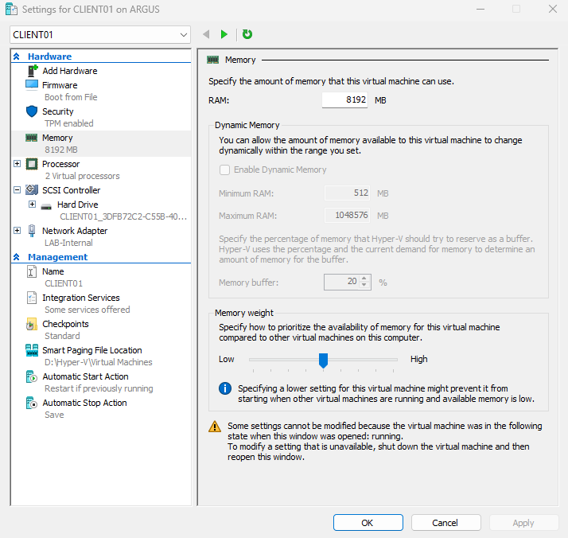
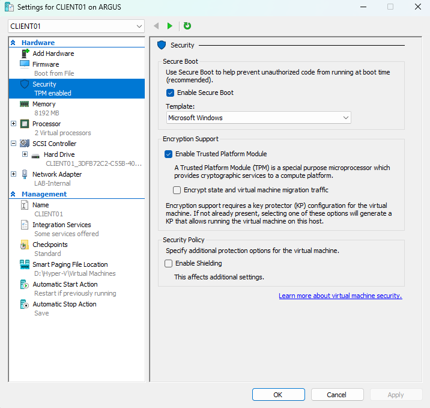
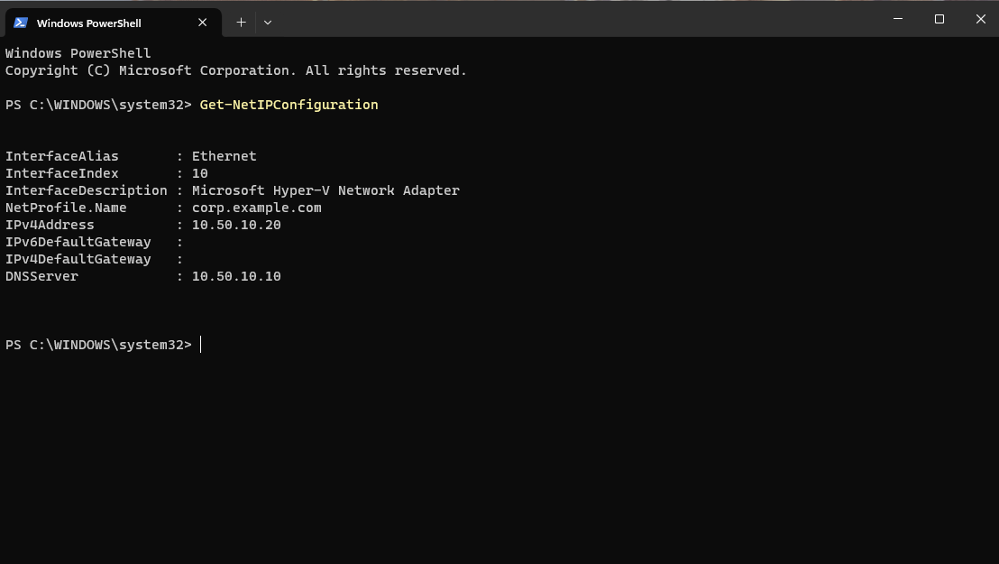
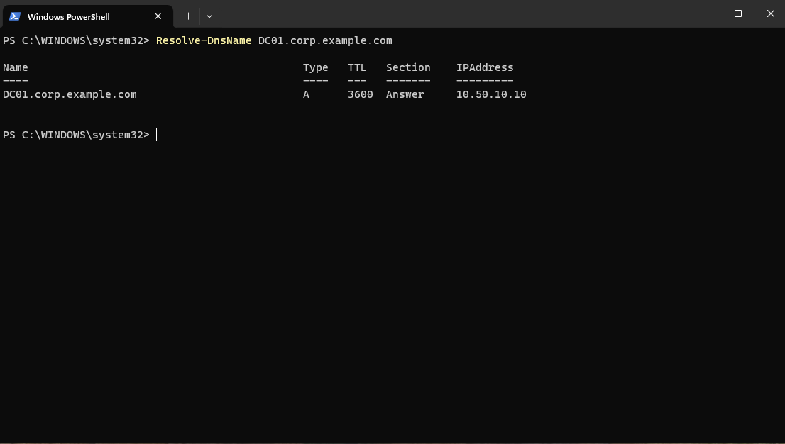
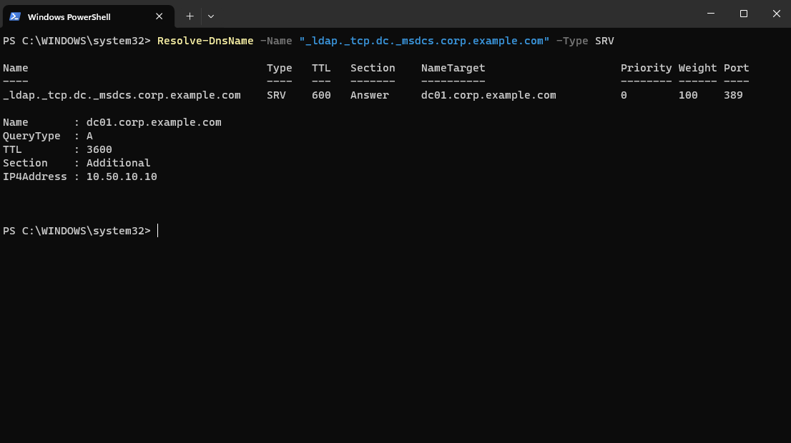
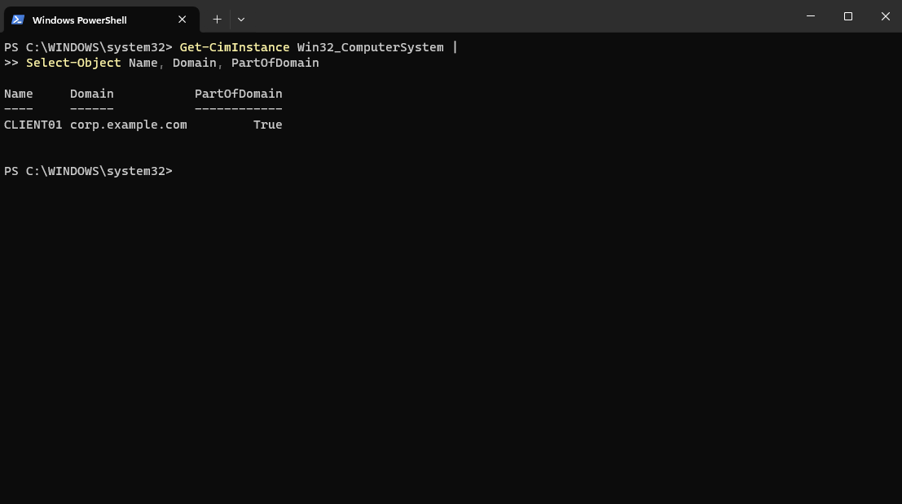
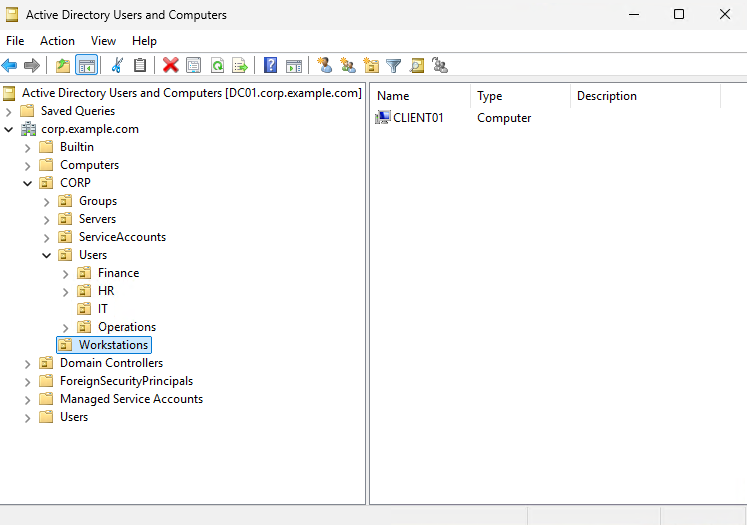
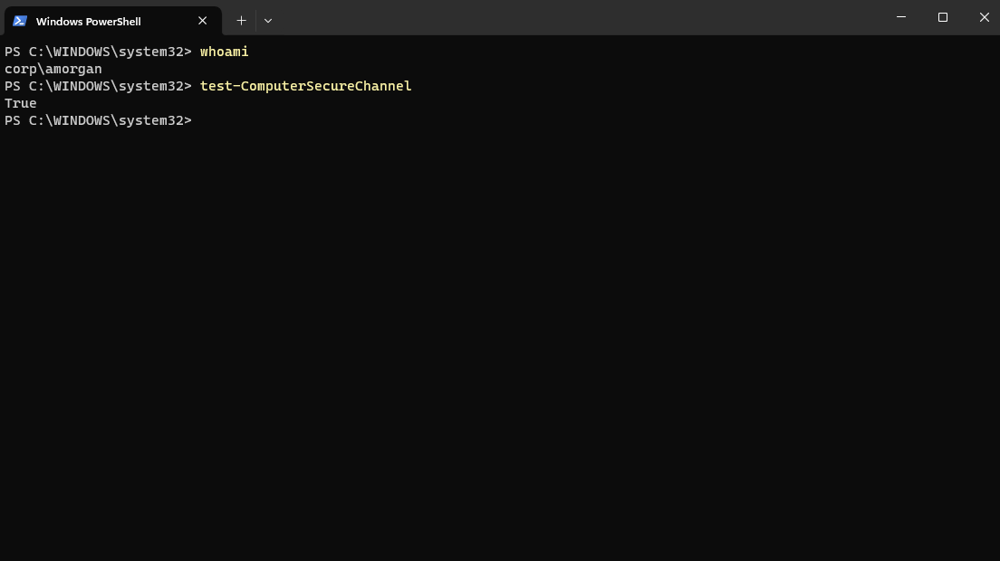
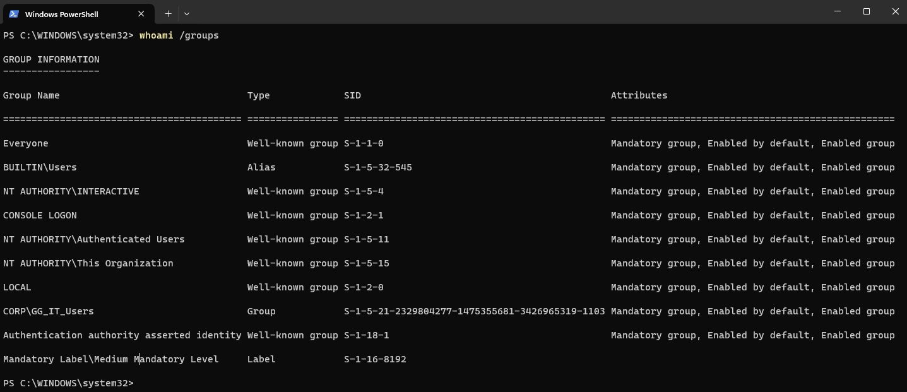
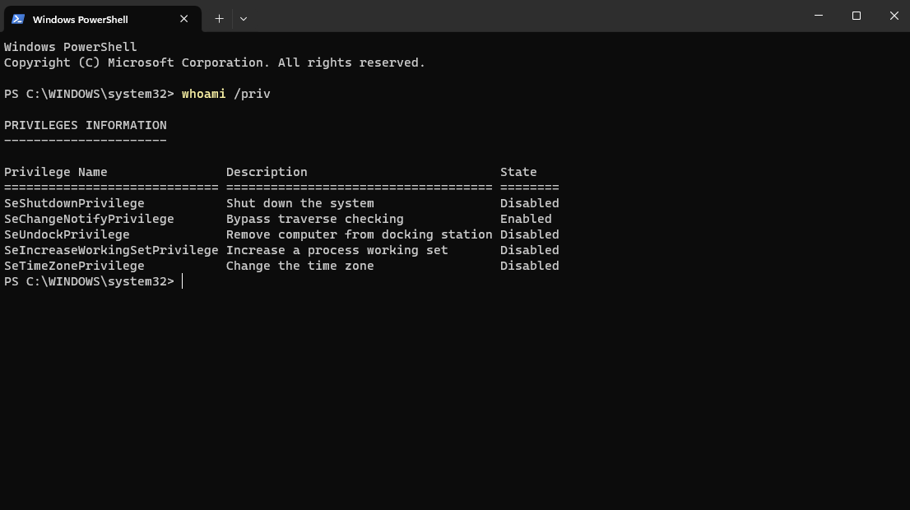

# Windows 11 Enterprise Workstation Deployment and Domain Integration

## Overview

This project documents the deployment and integration of CLIENT01, a Windows 11 Enterprise Evaluation virtual workstation, into the corp.example.com Active Directory domain hosted on the ARGUS Hyper-V lab environment.

The objective was to establish a functional enterprise client capable of authenticating domain users, resolving Active Directory DNS records, and communicating securely with the domain controller (DC01).

The deployment also provides a foundation for future Group Policy configuration, endpoint security testing, and centralized Windows administration.

## Deployment Objectives

- Provision a Generation 2 Windows 11 Enterprise virtual machine using Hyper-V.

- Configure Secure Boot and a virtual Trusted Platform Module (vTPM).

- Establish static IPv4 networking on the isolated LAB-Internal virtual switch.

- Configure DC01 as the workstation's preferred DNS server.

- Validate Active Directory DNS resolution and domain controller discovery.

- Join CLIENT01 to the corp.example.com domain.

- Organize the workstation computer object within the appropriate Active Directory organizational unit.

- Validate the domain secure channel and domain user authentication.

- Verify standard-user group membership and effective privileges.

## Lab Environment

| Component | Configuration |
|---|---|
| Hyper-V Host | ARGUS — Windows 11 Pro |
| Domain Controller | DC01 — Windows Server 2025 Evaluation |
| Workstation | CLIENT01 — Windows 11 Enterprise Evaluation |
| Active Directory Domain | `corp.example.com` |
| Virtual Network | `LAB-Internal` |
| Network Subnet | `10.50.10.0/24` |
| Domain Controller IPv4 | `10.50.10.10` |
| Workstation IPv4 | `10.50.10.20` |
| Preferred DNS Server | `10.50.10.10` |

## Hyper-V Workstation Provisioning

CLIENT01 was deployed on ARGUS as a Generation 2 Hyper-V virtual machine using the Windows 11 Enterprise Evaluation installation ISO. The workstation was configured to operate on the isolated LAB-Internal virtual switch alongside the domain controller.

### Virtual Machine Configuration

| Setting | Configuration |
|---|---|
| Virtual Machine | `CLIENT01` |
| Generation | 2 |
| Operating System | Windows 11 Enterprise Evaluation |
| Virtual Processors | 2 |
| Assigned Memory | 8192 MB (8 GB) |
| Dynamic Memory | Disabled |
| Virtual Hard Disk | 80 GB VHDX |
| VM Storage | `D:\Hyper-V\Virtual Hard Disks` |
| Virtual Switch | `LAB-Internal` |
| Secure Boot | Enabled |
| Virtual TPM | Enabled |

The workstation was allocated 8 GB of fixed memory and two virtual processors. Dynamic Memory was not enabled. Its virtual hard disk resides on the dedicated D: storage volume used for Hyper-V workloads.



### Virtual Machine Security

CLIENT01 was configured with Secure Boot using the Microsoft Windows template and a virtual Trusted Platform Module (vTPM). These settings support Windows 11 security requirements and provide a foundation for future guest operating system security features.

The virtual machine's encryption-of-state-and-migration option and shielding were left disabled. The VHDX is stored on ARGUS's BitLocker-protected D: volume; this provides host-level storage encryption but does not mean BitLocker is enabled inside the guest operating system.



### Installation and Initial Configuration

Windows 11 Enterprise Evaluation was installed from the attached ISO onto the new virtual hard disk. Following installation, the installation media was removed from the virtual DVD drive to prevent unintended boot attempts from the ISO.

A local administrative account, `LabAdmin`, was created during initial setup. This account was used for workstation configuration before domain integration. A separate domain user account was later used to validate standard-user authentication and permissions.

The Windows 11 Enterprise Evaluation installation was activated successfully. The evaluation license is time-limited and must be renewed through supported licensing or replaced when the evaluation period ends.

## Network Configuration and DNS Validation

### Static IPv4 Configuration

CLIENT01 was connected to the `LAB-Internal` Hyper-V virtual switch, providing communication with DC01 over the isolated `10.50.10.0/24` network.

The workstation was configured with a static IPv4 address and DC01 as its preferred DNS server.

| Network Setting | Configuration |
|---|---|
| Network Adapter | Ethernet — Microsoft Hyper-V Network Adapter |
| Virtual Switch | `LAB-Internal` |
| IPv4 Address | `10.50.10.20` |
| Subnet Mask | `255.255.255.0` |
| Default Gateway | None |
| Preferred DNS Server | `10.50.10.10` |
| Domain Controller | `DC01.corp.example.com` |

No default gateway was configured because the isolated lab subnet does not require routing to reach DC01. Using the domain controller as the preferred DNS server allows CLIENT01 to resolve Active Directory DNS records.

The network configuration was verified using PowerShell:

```powershell

Get-NetIPConfiguration

```

The output confirmed the expected IPv4 address, DNS server, and domain network profile.



### Domain Controller Hostname Resolution

Active Directory depends on DNS to locate domain controllers and other domain services. CLIENT01 was tested to verify that it could resolve DC01's fully qualified domain name (FQDN).

```powershell

Resolve-DnsName DC01.corp.example.com

```

The DNS query returned an A record resolving `DC01.corp.example.com` to `10.50.10.10`.



### Active Directory Service Discovery

Beyond ordinary hostname resolution, Active Directory uses DNS service (SRV) records to advertise services provided by domain controllers.

CLIENT01 queried the LDAP domain controller discovery record:

```powershell

Resolve-DnsName -Name "_ldap._tcp.dc._msdcs.corp.example.com" -Type SRV

```

The response identified DC01 as an LDAP service endpoint.

| SRV Record Property | Verified Result |
|---|---|
| Record | `_ldap._tcp.dc._msdcs.corp.example.com` |
| Record Type | SRV |
| Target | `dc01.corp.example.com` |
| Port | TCP 389 |
| Priority | 0 |
| Weight | 100 |
| Target IPv4 Address | `10.50.10.10` |

This result confirmed that CLIENT01 could retrieve the DNS service information required for domain controller discovery. It did not, by itself, test LDAP authentication or directory queries.



### Network Validation Summary

The workstation successfully resolved DC01's hostname and retrieved its Active Directory LDAP SRV record. Together with the configured static IPv4 address and preferred DNS server, these results established that CLIENT01 had the necessary DNS configuration for domain integration.

## Active Directory Domain Integration

### Joining CLIENT01 to the Domain

After configuring and validating network connectivity and DNS resolution, CLIENT01 was joined to the `corp.example.com` Active Directory domain.

The domain join was performed through Windows System Properties using credentials authorized to join computers to the domain. Windows prompted for a restart to apply the domain membership changes.

Following the restart, domain membership was verified using PowerShell:

```powershell

Get-CimInstance Win32_ComputerSystem |

    Select-Object Name, Domain, PartOfDomain

```

The command returned the following results:

| Property | Verified Value |
|---|---|
| Name | `CLIENT01` |
| Domain | `corp.example.com` |
| PartOfDomain | `True` |

The `PartOfDomain` property confirms that Windows recognizes CLIENT01 as a member of the Active Directory domain rather than a standalone workgroup computer.



### Active Directory Organizational Unit Placement

After the domain join, the CLIENT01 computer object was located in the default `Computers` container within Active Directory Users and Computers on DC01.

The computer object was subsequently moved into the custom `CORP/Workstations` organizational unit (OU), following the lab's existing directory structure.

The resulting distinguished name is:

```text

CN=CLIENT01,OU=Workstations,OU=CORP,DC=corp,DC=example,DC=com

```

Placing CLIENT01 in a dedicated workstation OU provides an organizational boundary for future workstation-specific Group Policy Objects (GPOs). It also separates workstation administration from server and domain controller management.



### Domain Secure Channel Validation

Domain membership alone does not guarantee that the computer's trust relationship with Active Directory is functioning correctly. Windows domain-joined computers maintain a secure channel used for communication with the domain.

While signed in to CLIENT01 using the domain account `CORP\amorgan`, the following commands were executed:

```powershell

whoami

Test-ComputerSecureChannel

```

The results were:

| Validation | Result |
|---|---|
| Current user | `corp\amorgan` |
| Secure channel test | `True` |

A result of `True` indicates that CLIENT01's secure channel with its domain is functioning at the time of testing. This provides additional validation beyond the domain membership property.



### Domain Integration Summary

CLIENT01 was successfully joined to `corp.example.com`, organized within the dedicated Workstations OU, and verified to have a functioning domain secure channel. These results establish the workstation as a managed Active Directory client and provide a foundation for centralized identity, access, and Group Policy management.

## Domain User Authentication and Least Privilege

### Domain User Account Configuration

An existing Active Directory user account, Alex Morgan (`amorgan`), was used to validate domain authentication on CLIENT01.

The account was located in the IT organizational unit and assigned to the departmental security group `GG_IT_Users`.

| Account Property | Configuration |
|---|---|
| Display Name | Alex Morgan |
| User Logon Name | `amorgan@corp.example.com` |
| Pre-Windows 2000 Logon Name | `CORP\amorgan` |
| Organizational Unit | `CORP/Users/IT` |
| Departmental Security Group | `GG_IT_Users` |
| Workstation | `CLIENT01` |

The account password was changed during the initial workstation sign-in process and stored securely outside the documentation repository. No passwords, recovery keys, or authentication secrets are included in this document.

### Domain Authentication and Group Membership

CLIENT01 was accessed interactively using the domain account `CORP\amorgan`. A PowerShell session was opened under the authenticated user's security context.

The following commands were executed:

```powershell

whoami

whoami /groups

```

The `whoami` command returned `corp\amorgan`, confirming the identity associated with the interactive session.

The group membership output included:

| Security Group | Significance |
|---|---|
| `CORP\GG_IT_Users` | Departmental Active Directory security group |
| `BUILTIN\Users` | Standard local user group |
| `NT AUTHORITY\Authenticated Users` | Authenticated Windows security principal |
| `Mandatory Label\Medium Mandatory Level` | Medium-integrity security context |

The displayed access token did not include membership in the local Administrators group. This is consistent with the account operating as a standard user rather than an elevated administrator.



### User Privilege Validation

To examine the privileges assigned to the current user access token, the following command was executed:

```powershell

whoami /priv

```

The output showed:

| Privilege | State |
|---|---|
| `SeShutdownPrivilege` | Disabled |
| `SeChangeNotifyPrivilege` | Enabled |
| `SeUndockPrivilege` | Disabled |
| `SeIncreaseWorkingSetPrivilege` | Disabled |
| `SeTimeZonePrivilege` | Disabled |

The limited privilege set and medium-integrity security context are consistent with a standard-user session. A privilege marked Disabled is present in the token but is not currently enabled; it does not necessarily indicate that the privilege can never be exercised.



### Security Significance

The validation demonstrated that an Active Directory account could authenticate to a domain-joined workstation and receive a Windows access token reflecting its security group memberships and assigned privileges.

Membership in the IT departmental security group did not automatically grant local administrative privileges on CLIENT01. This separation supports the principle of least privilege and provides a foundation for future role-based access controls and Group Policy enforcement.

### Deployment Validation Summary

CLIENT01 was successfully provisioned as a Windows 11 Enterprise Evaluation virtual machine, configured for the isolated lab network, joined to `corp.example.com`, and placed in the dedicated Workstations organizational unit.

DNS hostname resolution, Active Directory service discovery, domain membership, and the computer secure channel were validated. Domain user authentication, departmental group membership, and standard-user privileges were also verified.

This deployment establishes a functional Windows enterprise workstation that can be used for subsequent Group Policy, endpoint security, access control, and security event logging exercises.
